<p align="center">
  
</p>

# Finnish dialect speech-to-text

**We taught OpenAI's Whisper to understand Finnish dialects.** On dialect speech it gets about half as
many words wrong as before (40 % → 21 %), far fewer than any other model we tried, Gemini 3.5 Flash
included. Read and parliament speech stay about as good as before; on standard Finnish full of brand
names it gets more of the names wrong. The model and its training data are free to use.

🤗 [Model](https://huggingface.co/GAIK-project/whisper-large-v3-fi-dialects) ·
🗂️ [Training data](https://huggingface.co/datasets/GAIK-project/skn-finnish-dialects-asr) ·
🎬 [Video](https://gaik-project.github.io/finnish-asr/) ·
🔊 [Listen and compare](https://gaik-project.github.io/finnish-asr/listen.html) ·
📖 The story: [suomeksi](https://gaik-project.github.io/finnish-asr/story/story.fi.html) ·
[in English](https://gaik-project.github.io/finnish-asr/story/story.en.html) ·
🧰 [gaik-toolkit](https://github.com/GAIK-project/gaik-toolkit) ·
🌐 [gaik.ai](https://gaik.ai/)

Made by Akseli Leskinen ([laguagu](https://github.com/laguagu)), Haaga-Helia University of Applied
Sciences, in the [GAIK project](https://gaik.ai/), co-funded by the European Union (ERDF).

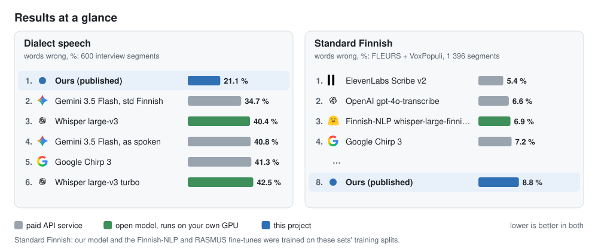

- 🗣️ **Dialect speech: our model, by far.** 21.1 % of words wrong. The next best is Gemini 3.5 Flash,
  34.7 % when asked for standard Finnish (40.8 % when asked to write as spoken); base Whisper large-v3
  gets 40.4 % and Google Chirp 3 41.3 % (35.0 % without one segment where it repeated “se on” 1 262
  times).
- 🏢 **Standard Finnish: the commercial services.** On read and parliament speech (FLEURS and
  VoxPopuli together) ElevenLabs Scribe v2 gets 5.4 % of words wrong, gpt-4o-transcribe 6.6 % and our
  model 8.8 %, a little better than base Whisper.
- ⚖️ **Four AI judges agree.** Claude and three open models on CSC's Aitta service all find far fewer
  meaning errors in our models' dialect transcripts than in base Whisper's.
- 🔌 **The big API services do not fix dialects.** On the second dialect corpus a blind judge gives
  Gemini 3.5 Flash 27.2 and OpenAI's gpt-4o-transcribe 34.2 meaning-error points per 100 words, more
  than base Whisper (25.0); our model gets 14.2. On read and parliament speech the API services lead
  ([four kinds of speech](#6-how-it-compares)).

| Our model against the model it started from | Whisper large-v3 | Our model |
|---|--:|--:|
| 🗣️ Dialect speech: words wrong | 40.4 % | **21.1 %** |
| ⚖️ Another dialect corpus: meaning-error points per 100 words | 25.9 | **13.6** |
| 📖 Read Finnish (FLEURS): words wrong | 7.4 % | 7.6 % |
| 🏛️ Parliament speech (VoxPopuli): words wrong | 12.7 % | **10.8 %** |

## 1. What it does

You give it Finnish speech, dialect or not. It writes standard Finnish, with punctuation.

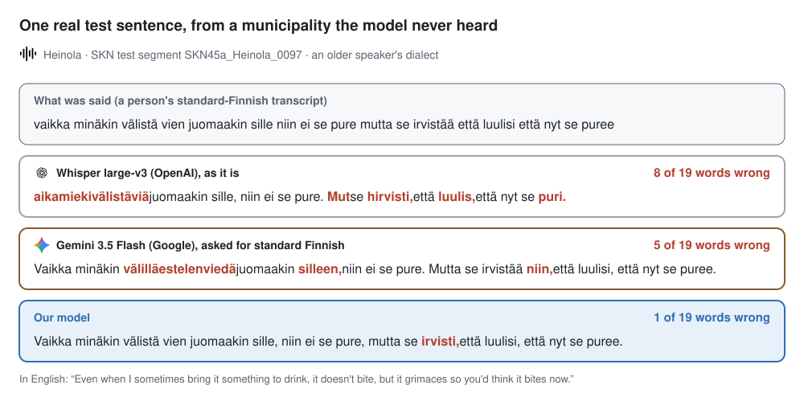

🔊 [Listen to this sentence and two more](https://gaik-project.github.io/finnish-asr/listen.html)

## 2. Where the data comes from

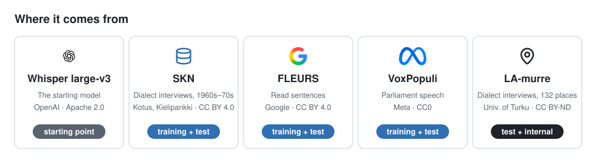

- **Whisper large-v3**, OpenAI: the model we started from. [openai/whisper-large-v3](https://huggingface.co/openai/whisper-large-v3), Apache 2.0.
- **SKN, Suomen kielen näytteitä**: dialect interviews from 50 municipalities, recorded in the
  1960s–70s, each sentence written down by a person. Kotus, via
  [Kielipankki](http://urn.fi/urn:nbn:fi:lb-2020112937), CC BY 4.0.
- **FLEURS**, Google: Wikipedia sentences read aloud. [google/fleurs](https://huggingface.co/datasets/google/fleurs), CC BY 4.0.
- **VoxPopuli**, Meta: European Parliament speeches. [facebook/voxpopuli](https://huggingface.co/datasets/facebook/voxpopuli), CC0.
- **LA-murre**: dialect interviews from 132 places. Its test set (10 places not in SKN) tests every
  model; only the internal version (below) also trained on the other places. University of Turku and
  Kotus, via [Kielipankki](http://urn.fi/urn:nbn:fi:lb-2020112935), CC BY-ND 4.0.

## 3. How we made it

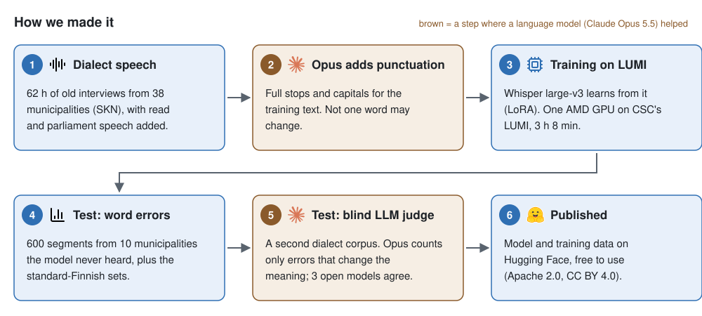

Training ran on [LUMI](https://www.lumi-supercomputer.eu/), the EuroHPC supercomputer hosted by CSC
in Kajaani. Every script is in [`scripts/`](scripts/); [Run it again](#run-it-again) lists the commands.

**Round by round:**

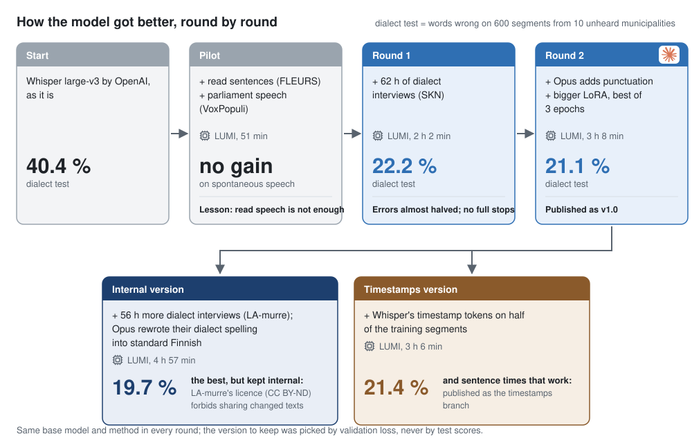

**Why is the best version not published?**

| | Published (`v1.0`) | Internal version |
|---|---|---|
| Training data | SKN + FLEURS + VoxPopuli, all open licences | the same + 56 h of LA-murre interviews |
| What the language model did | added punctuation | also rewrote LA-murre's dialect spelling in standard Finnish |
| Dialect test, words wrong | 21.1 % | **19.7 %** |
| Can it be shared? | ✅ yes, Apache 2.0 | ❌ no: LA-murre's licence (CC BY-ND) does not allow sharing changed texts, so the model trained on them stays internal |

## 4. What the language model did

The audio and the words are people's work. For the published model a language model, Claude Opus
5.5, helped in two places (for the internal version it also rewrote LA-murre's dialect spelling).
First, it added punctuation to the training text and nothing else:

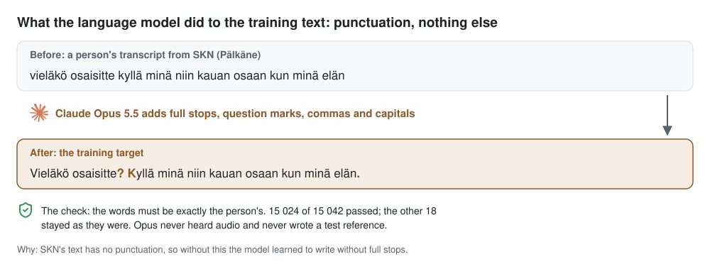

Second, it judged the test transcripts blind. A real example from the webinar:

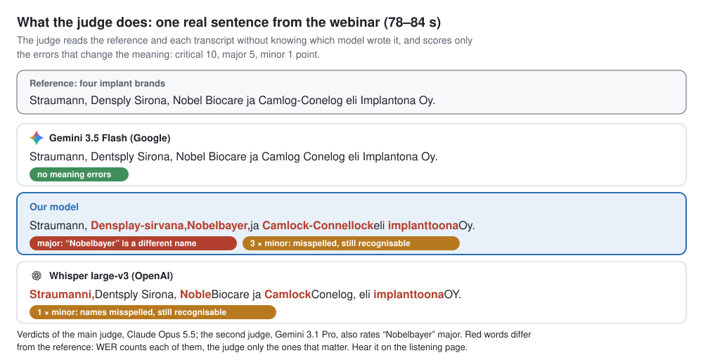

## 5. How we tested it

The test municipalities were kept out of training, so the test is speech the model had never heard:

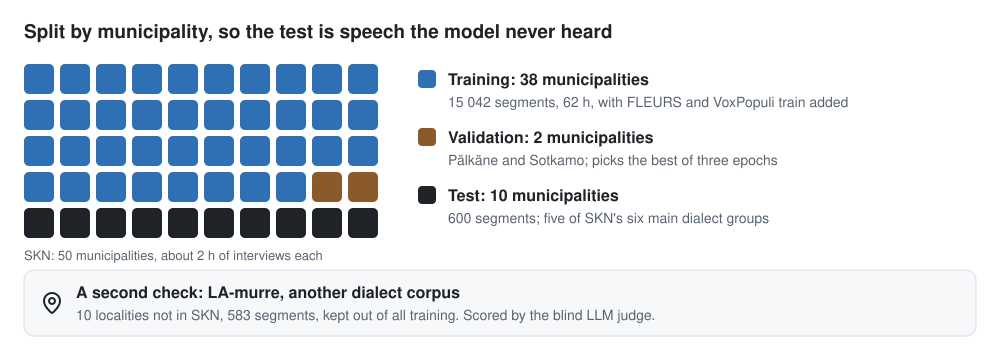

Two scores: word error rate counts every word that differs, the blind judge only errors that change the meaning:

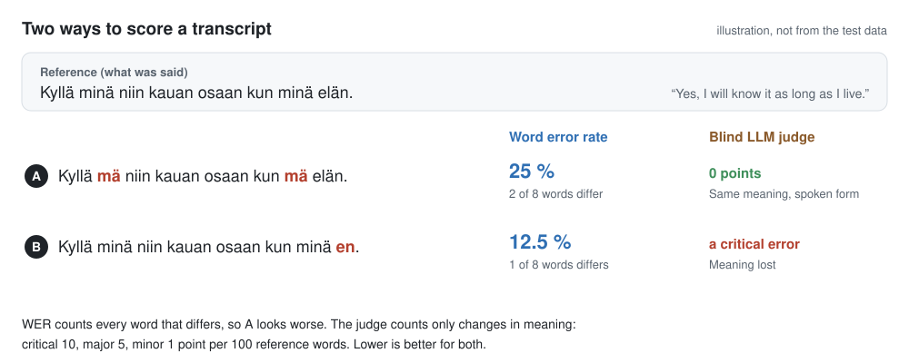

## 6. How it compares

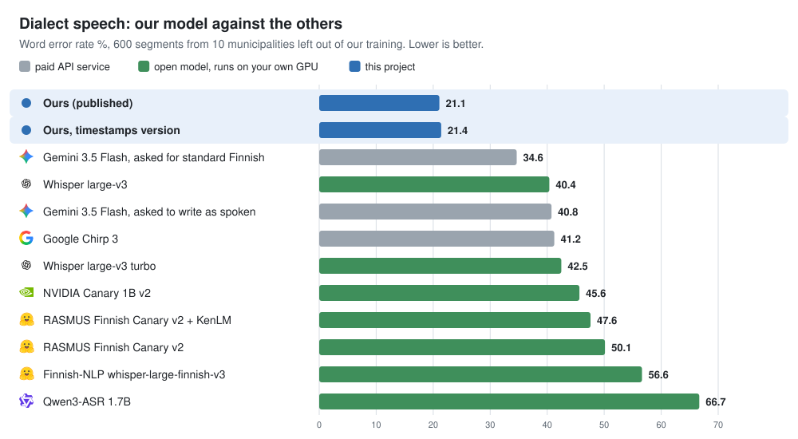

Across the open test sets, our model leads on dialect speech and parliament speech; on read
sentences gpt-4o-transcribe and Gemini are better:


On ten dental webinars (30 minutes), [the judges agree](#ten-dental-webinars-standard-spoken-finnish):
Gemini 3.5 Flash and ElevenLabs make the fewest meaning errors.

So: use our model for dialect speech, and Gemini 3.5 Flash or plain Whisper large-v3 for standard
business Finnish with many names. 🔊 [Hear the differences](https://gaik-project.github.io/finnish-asr/listen.html) ·
the single webinar clip and all 26 set-ups on it are in the [full details](#tldr).

## 7. Do other AI judges agree?

The fourth judging round put six transcripts of every segment of the second dialect corpus side by
side: base Whisper, two API services and our three models. Claude Opus 5.5 and OpenAI's GPT-6.1-sol
(through GAIK's Azure) judged all 583 segments, gpt-oss-120b on CSC's Aitta a seeded sample of 200.
Each judge is stricter or milder, but all three put our models far ahead, and Gemini 3.5 Flash and
gpt-4o-transcribe behind base Whisper:

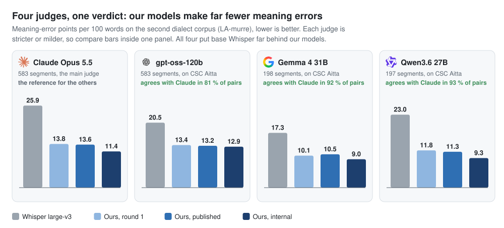

GPT-6.1-sol prefers the same transcript as Claude in 92 % of pairs, gpt-oss-120b in 86 %. The second
round's open judges (Gemma 4 31B, Qwen3.6 27B) agreed with Claude in 92–93 % of pairs
([below](#second-opinions-open-model-judges-on-csc-aitta)); in this round they were too slow on Aitta
to finish and are left out.

## 8. Why it got better

- 🎧 **It practised the exact task.** 62 hours of dialect speech, each sentence paired with a
  person's standard-Finnish transcript, from 38 municipalities.
- 🧭 **It learned dialects, not voices.** The 10 test municipalities were kept out, and it improved in
  all 10 of them.
- 🧱 **It kept what it knew.** Read and parliament speech stayed in the training mix, so they did not
  get worse (FLEURS 7.4 → 7.6 %, VoxPopuli 12.7 → 10.8 %).
- ✍️ **It writes sentences.** With punctuation added to the training text, its output reads like text.
- ➕ **More dialect speech helps further.** The internal version with 56 more hours
  ([counts](results/labels/lamurre_train.hours.stats.json)) gets 19.7 %.
- 🏷️ **What got worse: rare names.** The interviews have no brand names or dental terms, and the
  fine-tuned model spells them worse than base Whisper does; for those, use a general model.

## 9. Use it

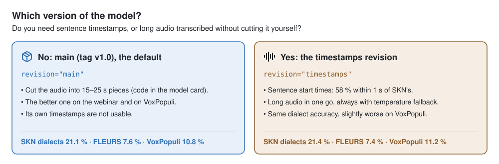

```python
import soundfile as sf
from transformers import pipeline  # pip install "transformers>=5" torch soundfile

asr = pipeline("automatic-speech-recognition", model="GAIK-project/whisper-large-v3-fi-dialects")
audio, sr = sf.read("clip.wav", dtype="float32")  # 16 kHz mono, up to 30 s
print(asr({"raw": audio, "sampling_rate": sr}, generate_kwargs={"language": "fi", "task": "transcribe"})["text"])
```

For longer audio, the [model card](https://huggingface.co/GAIK-project/whisper-large-v3-fi-dialects)
has code that cuts it into pieces at quiet moments.

---

# Full details

Everything below is the full report: every model, every number, how each was measured, and the caveats.


Organisations ask whether there are speech-to-text models that understand Finnish, dialects
included, and can run locally. This repository runs 20 current speech-to-text set-ups, 12 of them
open models that run on your own GPU, on one Finnish webinar clip and scores them two ways: word
error rate, and two blind LLM judges that count only the errors that change the meaning. It then
measures the open models on four public test sets, two of them dialect corpora, and fine-tunes
Whisper large-v3 for Finnish dialects: that model and its training data are published on Hugging
Face.

The clip is **Ajokortti**: a 180 s excerpt of a public QAdental dental-education webinar (QAdental,
Suomen Kotilääkäripalvelu Oy, is a GAIK project partner), two speakers, standard spoken Finnish with
many names and brand names. It and the University of Helsinki (HY) team's reference transcript are
published in gaik-toolkit's
[transcription_eval](https://github.com/GAIK-project/gaik-toolkit/tree/main/evaluation_layer/eval_methods/transcription_eval);
[`get_clip.py`](scripts/get_clip.py) downloads them from there, they are not copied here. Some
transcripts come from **QAD-1**, GAIK's earlier re-run of HY's evaluation of this clip. The clip is
**not dialect speech**: dialects are measured on held-out parts of two dialect corpora
([Public test sets](#public-test-sets-skn-and-la-murre-dialects-fleurs-and-voxpopuli),
[Our dialect model](#our-dialect-model)).

## TL;DR

- 🏆 **Fewest meaning errors: Gemini 3.5 Flash**, first for both judges. Next come
  Google Chirp 3, ElevenLabs Scribe v2 and, as the best open models, plain **Whisper
  large-v3** and **large-v3 turbo**; the judges order those four differently.
- 📏 **WER ranks the models differently.** The Finnish-NLP Whisper fine-tune has the
  lowest WER (11.9 %) but more meaning errors than base Whisper large-v3 (14.7 %): it
  garbles brand names ("Nobel-Baker", "Kamloch-Konelloch"). ElevenLabs has a WER of
  18.2 % but only 5 minor errors for Claude, because it writes what was said ("mä", "semmonen")
  where the reference has standard forms. The reference also looks like a corrected
  WhisperX draft, which favours Whisper-family output on WER.
- 👂 **A listener's review of the reference confirms it.** After the 42 spans most systems
  disputed were checked by ear (14 corrected), the WhisperX lead disappears and the leading set
  sits within about one point, 13.2–14.2 % WER ([Reviewed reference](#reviewed-reference)).
- 🖥️ **Local and good enough: Whisper large-v3 or large-v3 turbo.** Every other open
  model is clearly behind on this clip: Orukeet, RASMUS Finnish Canary, Canary 1B v2,
  Parakeet v3 and wav2vec2 at 22–32 % WER.
- ❌ **Qwen3-ASR is not usable for Finnish**: 58 % WER (1.7B) and 78 % (0.6B), although
  Finnish is on its language list.
- 🇫🇮 **The Finnish Canary fine-tune did not beat its base on names.** RASMUS
  Finnish-ASR-Canary-v2 scores 22–24 % WER against 24 % for NVIDIA's Canary 1B v2, and
  gets fewer of the 14 names right (7–11 against 10–13). Its model card reports 4.6 %
  on Common Voice: read speech, not a webinar.
- 🗣️ **Dialects: every model struggles, and fine-tuning on dialect data nearly halves
  the errors.** On 600 dialect segments from 10 municipalities kept out of our training, the
  best ready-made open model (Whisper large-v3) has 40 % WER, the Finnish fine-tunes 48–57 % and
  the best API service we ran, Gemini 3.5 Flash asked for standard Finnish, 34.7 %. A LoRA fine-tune of Whisper large-v3 on 62 h of open dialect interviews
  (SKN, CC BY 4.0) brings it to **22 %**, better in all 10 municipalities, with FLEURS
  and VoxPopuli kept about level. A second, independent dialect corpus (LA-murre, 10
  other localities) confirms it on meaning: a blind judge gives the fine-tune 13.8
  meaning-error points per 100 words against 25.9 for base Whisper (round-2 judging),
  better in all 10 localities.
- 🛠️ **Our own model, round 2: punctuation back, and more dialect speech helps.** An LLM
  added punctuation to the training text (round 1 wrote almost none), and a second run added
  56 h of LA-murre interviews rewritten in standard Finnish. The published model keeps
  round 1's dialect accuracy (SKN 21.1 % WER, judge 13.6 against base Whisper's 25.9) and
  writes sentences. The internal one with LA-murre is the best on both dialect tests
  (19.7 %, 11.4 points), but LA-murre's no-derivatives licence keeps it private. On the webinar
  clip all of them spell rare names and dental terms worse than base Whisper
  ([Our dialect model](#our-dialect-model)).
- ⚖️ **Three open judges agree.** Given the same blind task on CSC's Aitta service, gpt-oss-120b
  (all 583 LA-murre segments) puts the four models in Claude's order and prefers the same model as
  Claude in 81 % of the pairs; Gemma 4 31B and Qwen3.6 27B, on a sample, in 92–93 %. Every judge
  ranks the internal model first, the published model and round 1 about level, and base Whisper
  clearly last ([Second opinions](#second-opinions-open-model-judges-on-csc-aitta)).
- ⏱️ **Timestamps: a second variant.** The published model's own timestamps are unusable (1 % of
  SKN sentence starts get one within 1 s; base Whisper 61 %), so decode it in pieces. The same recipe
  trained with Whisper's timestamp tokens finds 58 %, keeps the dialect accuracy (SKN 21.4 %
  against 21.1 %) and, with OpenAI's temperature fallback, transcribes 4-minute dialect interviews
  in one go at 18.1 % WER without loops. It is published as the `timestamps` revision; the main
  model stays as it was
  ([Timestamps and long-form audio](#timestamps-and-long-form-audio)).
- 🆕 **15 Oct 2026: every service on every test set.** gpt-4o-transcribe, ElevenLabs Scribe v2,
  Chirp 3 and Gemini 3.5 Flash also ran on FLEURS, VoxPopuli and SKN: on read and parliament speech
  ElevenLabs is best (3.3 % and 9.1 %), on dialects every service is at 35–63 %. A fourth judging
  round (Claude, GPT-6.1-sol, gpt-oss-120b) puts Gemini and gpt-4o-transcribe behind base Whisper on
  LA-murre ([Do other AI judges agree?](#7-do-other-ai-judges-agree)), and on ten dental webinars
  judged on meaning Gemini 3.5 Flash is first ([Ten dental webinars](#ten-dental-webinars-standard-spoken-finnish)).
  A model trained on all of SKN is the `all-skn` branch ([next steps](#dialect-data-and-next-steps)).
- 🤗 **Published 13 Oct 2026:** the model
  [GAIK-project/whisper-large-v3-fi-dialects](https://huggingface.co/GAIK-project/whisper-large-v3-fi-dialects)
  (Apache 2.0, tag `v1.0`; variants on its `timestamps` and `all-skn` branches) and its SKN segments
  [GAIK-project/skn-finnish-dialects-asr](https://huggingface.co/datasets/GAIK-project/skn-finnish-dialects-asr)
  (CC BY 4.0). This repository holds the method, the code and the results behind them.

<!-- readme-table:start -->
| Model | Type | WER % | CER % | Claude pts | Gemini pts | Names (Claude / Gemini) |
|---|---|--:|--:|--:|--:|--:|
| Gemini 3.5 Flash | API | 14.2 (14.2–17.9) | 5.0 | 0.8 | 1.2 | 14 / 14 of 14 |
| Google Chirp 3 | API | 19.6 | 6.6 | 1.2 | 3.7 | 14 / 11 of 14 |
| Whisper large-v3, chunked decoding | open | 15.7 | 6.7 | 1.7 | 5.5 | 14 / 14 of 14 |
| Whisper large-v3 | open | 14.7 | 6.0 | 2.7 | 5.2 | 14 / 13 of 14 |
| ElevenLabs Scribe v2 | API | 18.2 (17.2–18.4) | 4.9 | 1.2 | 7.0 | 14 / 12 of 14 |
| This project, round 2 internal (+ LA-murre), chunked | open | 15.9 | 4.7 | 3.0 | 6.2 | 14 / 12 of 14 |
| Whisper large-v3 turbo | open | 18.4 | 7.7 | 1.5 | 8.5 | 14 / 13 of 14 |
| This project's pilot: Whisper large-v3 + LoRA on FLEURS and VoxPopuli | open | 17.9 | 8.3 | 2.2 | 8.2 | 14 / 13 of 14 |
| OpenAI gpt-transcribe | API | 18.4 (18.4–19.1) | 8.5 | 4.2 | 8.5 | 12 / 12 of 14 |
| WhisperX + Finnish-NLP whisper-large-finnish-v3 (Haaga-Helia WhisperX server) | open | 11.9 | 3.5 | 4.5 | 8.7 | 13 / 11 of 14 |
| This project, round 1, chunked decoding | open | 14.9 | 5.3 | 3.7 | 9.7 | 14 / 13 of 14 |
| OpenAI gpt-4o-transcribe | API | 16.9 (16.2–18.4) | 6.7 | 6.0 | 7.5 | 11 / 10 of 14 |
| OpenAI whisper-1 | API | 23.1 | 11.2 | 3.0 | 10.4 | 14 / 14 of 14 |
| Finnish-NLP whisper-large-finnish-v3 (plain transformers) | open | 13.2 | 4.3 | 5.2 | 8.5 | 13 / 11 of 14 |
| This project, round 1: Whisper large-v3 + LoRA on SKN dialects, FLEURS and VoxPopuli | open | 17.9 | 5.6 | 4.5 | 9.4 | 13 / 12 of 14 |
| OpenAI gpt-4o-mini-transcribe | API | 13.9 (13.9–14.7) | 4.4 | 3.2 | 11.4 | 13 / 10 of 14 |
| Orukeet (Parakeet v3 fine-tune) | open | 26.4 | 10.2 | 6.2 | 10.7 | 13 / 11 of 14 |
| This project, round 2 (published), chunked decoding | open | 13.9 | 5.2 | 6.7 | 10.9 | 11 / 10 of 14 |
| RASMUS Finnish-ASR-Canary-v2, greedy | open | 23.9 | 8.1 | 6.5 | 13.7 | 11 / 8 of 14 |
| RASMUS Finnish-ASR-Canary-v2 + KenLM | open | 22.1 | 8.5 | 8.5 | 15.4 | 11 / 7 of 14 |
| Gemini 3.1 Pro | API | 22.4 (15.4–22.4) | 9.3 | 7.0 | 18.4 | 12 / 10 of 14 |
| NVIDIA Canary 1B v2 | open | 24.1 | 10.3 | 9.0 | 17.9 | 13 / 10 of 14 |
| NVIDIA Parakeet TDT 0.6B v3 | open | 31.1 | 13.8 | 12.7 | 17.4 | 13 / 12 of 14 |
| Finnish-NLP wav2vec2 XLS-R 1B (no LM) | open | 31.6 | 9.1 | 6.2 | 26.1 | 13 / 10 of 14 |
| Qwen3-ASR 1.7B | open | 58.0 | 23.2 | 20.6 | 33.6 | 9 / 7 of 14 |
| Qwen3-ASR 0.6B | open | 77.9 | 33.9 | 28.1 | 41.0 | 7 / 4 of 14 |
<!-- readme-table:end -->

Results on the Ajokortti clip, sorted by the mean of the two judges. **pts** = meaning-error points
per 100 reference words (critical 10, major 5, minor 1), lower is better. **Names** = how many of the
clip's 14 names and terms each judge found right or recognisable. WER and CER use HY's normalisation
(lower-case, every Unicode punctuation character removed, runs of whitespace collapsed; see the
toolkit's [What the metrics mean](https://github.com/GAIK-project/gaik-toolkit/tree/main/evaluation_layer/eval_methods/transcription_eval#what-the-metrics-mean));
the range is over three runs where a model was run three times. "open" = weights can be downloaded
and run on your own GPU. All numbers per model are in [`results/scores.json`](results/scores.json).
File names in `results/` start with where the model ran: `openai_`, `vertex_` (Gemini),
`elevenlabs_` and `google_` (Chirp) are APIs, `gaik_` the gaik toolkit's transcriber, `hh_` the
Haaga-Helia WhisperX server, `hf_`, `nemo_` and `qwen_` open models on a GPU, `ft_` our fine-tunes.

## Reviewed reference

The clip's reference is HY's transcript, which looked like a corrected WhisperX draft. On 14 Oct
2026 Akseli Leskinen listened to the 42 spans where most of seven systems hear something else and
corrected 14 of them: mostly spoken forms HY had written in standard Finnish, two missing words and a
brand name. The reviewed text is published next to the original in gaik-toolkit
([`reference.reviewed.txt`](https://raw.githubusercontent.com/GAIK-project/gaik-toolkit/main/evaluation_layer/eval_methods/transcription_eval/data/reference.reviewed.txt)).
Against it ([`results/scores.reviewed.json`](results/scores.reviewed.json), `score_asr.py --reviewed`):

| Model | WER %, HY's reference | WER %, reviewed |
|---|--:|--:|
| OpenAI gpt-4o-mini-transcribe | 13.9 | **13.2** |
| Whisper large-v3 | 14.7 | 13.7 |
| Gemini 3.5 Flash | 14.2 | 13.7 |
| Our model, round 2 (published), chunked | 13.9 | 14.0 |
| ElevenLabs Scribe v2 | 18.2 | 14.2 |
| WhisperX + Finnish-NLP whisper-large-finnish-v3 (Haaga-Helia WhisperX server) | 11.9 | 15.7 |
| Finnish-NLP whisper-large-finnish-v3 (plain transformers) | 13.2 | 15.7 |

The WhisperX-based arms lose their lead and ElevenLabs, which writes what is said, gains four
points: the review confirms that HY's text favoured WhisperX output. HY's own 2025 WhisperX file shows
the same shift (10.4 → 14.0 %, reported in gaik-toolkit; that transcript is not part of this
repository). The leading set now sits within about one point (13.2–14.2 %), which a 408-word
reference cannot separate. Only the 42 disputed spans were checked, so read every WER here with the rest of the
reference still unverified. The tables above and the judges' scores are against HY's text and were
not re-run.

## Public test sets: SKN and LA-murre dialects, FLEURS and VoxPopuli

The clip above is one recording. Four open Finnish test sets:

- **SKN dialects**: 600 segments (2.5 h) of dialect interviews from 10 municipalities
  in five of SKN's six main dialect groups (no Ostrobothnian or Peräpohjola one), cut from Suomen
  kielen näytteitä (Kotus / Kielipankki, CC BY 4.0) by [`prepare_skn.py`](scripts/prepare_skn.py).
  The reference is SKN's normalised transcript: standard Finnish word forms, no punctuation. A model
  is right when it hears the dialect and writes standard Finnish. The test segments are the `test`
  split of the [published dataset](https://huggingface.co/datasets/GAIK-project/skn-finnish-dialects-asr).
- **LA-murre dialects**: 583 segments (2.3 h) from 10 localities that are not in SKN,
  cut from the Finnish Dialect Syntax Archive (University of Turku / Kotus, Kielipankki,
  CC BY-ND 4.0) by [`prepare_lamurre.py`](scripts/prepare_lamurre.py). No published model was
  trained on any of LA-murre; only the internal model was, on recordings from other localities,
  never these 10. Its reference is a **dialect** transcript, so WER here charges a model for writing standard
  Finnish: every model lands at 52–73 %. Read this column with the
  [meaning judge](#a-second-corpus-la-murre), not on its own. Only the numbers are published
  ([`results/benchmarks/lamurre_fi/scores.json`](results/benchmarks/lamurre_fi/scores.json)): the
  licence does not allow sharing the modified references, the transcripts paired with them or the
  judge records, and `prepare_lamurre.py` rebuilds the test from Kielipankki.
- **FLEURS** (Google, CC BY 4.0): 918 Wikipedia sentences read aloud, about 10 s each.
- **VoxPopuli** (Meta, CC0): 478 European Parliament speech segments.

FLEURS and VoxPopuli are prepared or read speech, the sets model cards report; SKN is
spontaneous speech from mostly elderly speakers, recorded in the 1960s–70s.

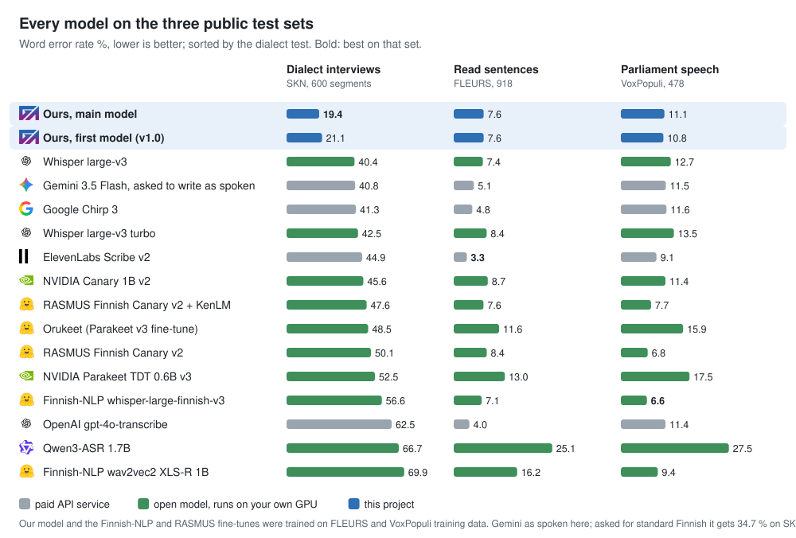

<!-- benchmark-table:start -->
| Model | SKN dialects WER % | LA-murre dialects WER % | FLEURS WER % | VoxPopuli WER % | FLEURS CER % | s / clip |
|---|--:|--:|--:|--:|--:|--:|
| **This project's pilot: Whisper large-v3 + LoRA** †‡ | – | – | 7.1 | 10.8 | 1.6 | 0.95 |
| **This project, trained on all of SKN (its test included, so no SKN score)** †‡§ | – | 57.8 | 7.5 | 11.9 | 1.7 | 0.96 |
| Orukeet (Parakeet v3 fine-tune) | – | – | 11.6 | 15.9 | 2.8 | 0.04 |
| NVIDIA Parakeet TDT 0.6B v3 | – | – | 13.0 | 17.5 | 3.1 | 0.18 |
| Finnish-NLP wav2vec2 XLS-R 1B (no LM) | – | – | 16.2 | 9.4 | 6.2 | 1.50 |
| **This project, round 2 internal: + LA-murre** †‡§¶ | 19.7 | 57.4 | 7.8 | 11.4 | 1.8 | 0.96 |
| **This project, round 2: + punctuated SKN targets (published)** †‡§ | 21.1 | 58.1 | 7.6 | 10.8 | 1.7 | 0.98 |
| **This project, round 2 + timestamp tokens (`timestamps` revision)** †‡§ | 21.4 | 58.1 | 7.4 | 11.2 | 1.7 | 0.98 |
| **This project, round 1: Whisper large-v3 + LoRA incl. SKN dialects** †‡§ | 22.2 | 57.9 | 7.8 | 10.6 | 1.9 | 0.96 |
| Gemini 3.5 Flash (API, asked for standard Finnish) | 34.7 | 61.8 | – | – | – | – |
| Whisper large-v3 | 40.4 | 62.5 | 7.4 | 12.7 | 1.7 | 0.98 |
| Gemini 3.5 Flash (API, asked to write as spoken) | 40.8 | 60.2 | 5.1 | 11.5 | 1.9 | 2.24 |
| Google Chirp 3 (API) | 41.3 | – | 4.8 | 11.6 | 1.6 | 1.82 |
| Whisper large-v3 turbo | 42.5 | 62.7 | 8.4 | 13.5 | 2.2 | 0.19 |
| ElevenLabs Scribe v2 (API) | 44.9 | – | 3.3 | 9.1 | 1.7 | 3.09 |
| NVIDIA Canary 1B v2 | 45.6 | 65.6 | 8.7 | 11.4 | 2.1 | 0.30 |
| RASMUS Finnish-ASR-Canary-v2 + KenLM †‡ | 47.6 | 62.7 | 7.6 | 7.7 | 2.5 | 0.71 |
| RASMUS Finnish-ASR-Canary-v2, greedy †‡ | 50.1 | 58.7 | 8.4 | 6.8 | 2.4 | 0.10 |
| Finnish-NLP whisper-large-finnish-v3 † | 56.6 | 51.6 | 7.1 | 6.6 | 1.7 | 0.89 |
| OpenAI gpt-4o-transcribe (API, via Azure) | 62.5 | 72.6 | 4.0 | 11.4 | 1.4 | 0.88 |
| Qwen3-ASR 1.7B | 66.7 | 72.9 | 25.1 | 27.5 | 5.8 | 0.34 |
<!-- benchmark-table:end -->

Corpus WER and CER after lower-casing and removing punctuation. Seconds per utterance
are FLEURS GPU time in batches of 16 on one AMD MI250X, model loading excluded. † trained
on FLEURS training data, ‡ on VoxPopuli training data, § on SKN training data from
other municipalities, ¶ on LA-murre training data from other localities (model cards, or this
project), so those numbers are on familiar material. A dash: not run on that set. The API services
([`run_api_benchmark.py`](scripts/run_api_benchmark.py)) ran with the clip runs' models and settings,
one request per segment; OpenAI's gpt-4o-transcribe through GAIK's Azure. Seconds per clip for them
are request wall time, which varies with the service's load. "As spoken" is the clip's
prompt (write exactly what is said); "standard Finnish" asks for standard word forms, which is what the
SKN reference has. Chirp 3 returned 1 262 words of a repeated "se on" for one 50-word segment
(SKN15b_Rautu_0133), which costs it 6.3 points (35.0 % without that segment), and heard no speech in 8
segments, counted as deletions. The API services' training data is unknown, so for them the test
municipalities cannot be called held out.
VoxPopuli references keep digits and abbreviations as the parliament wrote them, which costs every
model some WER. The RASMUS model card reports 8.39 % (greedy) and 7.75 % (KenLM) on FLEURS; this run
gives 8.4 % and 7.6 %.

## Ten dental webinars: standard spoken Finnish

The Ajokortti clip is one of ten. The other nine come from the same QAdental webinar material: ten
180 s clips (30 minutes of speech), each with the University of Helsinki's Finnish
transcript (QAD-1 set A in HY's study). The files were checked against HY's originals: the same audio
and the same text byte for byte.


**Read the word error rate here with care.** HY's transcripts leave out fillers ("niinku", "tota",
"no niin") and were not checked against the audio by a listener. A spot check found missing fillers,
a wrong word form ("yrittäjien" where the speaker says "yrittäjän") and a word missing at a clip's
start; the Ajokortti review above found the same. So models that also leave fillers out (Whisper,
gpt-4o-transcribe) get about 2 % of inserted words, and models that write what is said (ElevenLabs,
Chirp, Gemini, our model) 11–14 %. The blind judges of [`judge_dental.py`](scripts/judge_dental.py)
(the Ajokortti prompt, Claude Opus 5.5 and Gemini 3.1 Pro) ignore fillers and count only what
changes the meaning; on that measure Gemini 3.5 Flash and ElevenLabs Scribe v2 are best, and our
model, built for dialects, is last of the six judged.

<!-- dental-table:start -->
| Model | WER % | Inserted words % | Meaning points, Claude Opus 5.5 | Meaning points, Gemini 3.1 Pro |
|---|--:|--:|--:|--:|
| Whisper large-v3 | 15.7 | 2.7 | 3.6 | 6.4 |
| Whisper large-v3, in 15–25 s pieces | 17.4 | 2.2 | – | – |
| OpenAI gpt-4o-transcribe (API, via Azure) | 19.1 | 2.4 | 5.3 | 9.1 |
| Whisper large-v3 turbo | 19.2 | 2.2 | – | – |
| OpenAI Whisper (API, via Azure) | 22.1 | 2.6 | – | – |
| Orukeet (Parakeet v3 fine-tune) | 24.4 | 2.3 | – | – |
| NVIDIA Canary 1B v2 | 24.5 | 2.2 | – | – |
| ElevenLabs Scribe v2 (API) | 25.4 | 11.4 | 1.6 | 2.8 |
| **This project, all of SKN, in pieces** †‡§ | 25.7 | 12.5 | 4.8 | 9.7 |
| **This project, `timestamps` revision, in pieces** †‡§ | 25.8 | 12.9 | – | – |
| Finnish-NLP whisper-large-finnish-v3 † | 25.8 | 12.7 | – | – |
| **This project, published, in 15–25 s pieces** †‡§ | 25.9 | 12.8 | 5.1 | 10.0 |
| Google Chirp 3 (API) | 25.9 | 11.3 | 2.3 | 3.7 |
| **This project, internal, in pieces** †‡§¶ | 26.5 | 13.4 | – | – |
| Gemini 3.5 Flash (API, asked for standard Finnish) | 26.5 | 13.7 | – | – |
| **This project, `timestamps` revision, long audio in one go** †‡§ | 27.0 | 13.0 | – | – |
| Gemini 3.1 Pro (API) | 28.5 | 11.4 | – | – |
| RASMUS Finnish-ASR-Canary-v2 + KenLM †‡ | 28.6 | 9.9 | – | – |
| Gemini 3.5 Flash (API, asked to write as spoken) | 28.6 | 14.0 | 1.2 | 2.1 |
| RASMUS Finnish-ASR-Canary-v2, greedy †‡ | 29.7 | 8.8 | – | – |
| **This project, round 2 + timestamp tokens (`timestamps` revision)** †‡§, whole clip in one go | 29.8 | 15.8 | – | – |
| NVIDIA Parakeet TDT 0.6B v3 | 32.3 | 1.8 | – | – |
| Finnish-NLP wav2vec2 XLS-R 1B (no LM) | 42.1 | 5.9 | – | – |
| **This project, round 2 internal: + LA-murre** †‡§¶, whole clip in one go | 60.0 | 44.9 | – | – |
| **This project, round 2: + punctuated SKN targets (published)** †‡§, whole clip in one go | 60.2 | 44.8 | – | – |
| Qwen3-ASR 1.7B | 93.7 | 35.4 | – | – |
<!-- dental-table:end -->

Meaning points: errors per 100 reference words over all ten clips (critical 10, major 5, minor 1).
Our models were run on 15–25 s pieces cut at quiet points; fed a whole 180 s clip in one go, the
published model repeats itself (45 % inserted words), and only the `timestamps` revision with its
fallback decode copes. HY's transcripts are private, so only the numbers are committed
([`results/benchmarks/dental10_fi/scores.json`](results/benchmarks/dental10_fi/scores.json),
[`results/judgements_dental/summary.json`](results/judgements_dental/summary.json)).

## Fine-tuning pilot: Whisper large-v3 on open Finnish data

Can the open training data improve the best open model? A LoRA fine-tune of Whisper
large-v3 (1 % of the weights, rank 32 on the attention query and value projections) on
the FLEURS and VoxPopuli Finnish training sets: 10 208 recordings, 2 epochs, 51 minutes
on one MI250X. Validation loss fell from 0.48 to 0.17.

| Test | Whisper large-v3 | After fine-tuning |
|---|--:|--:|
| FLEURS WER % | 7.4 | 7.1 |
| VoxPopuli WER % | 12.7 | 10.8 |
| Ajokortti clip WER % | 14.7 | 17.9 |
| Ajokortti, Claude / Gemini error points | 2.7 / 5.2 | 2.2 / 8.2 |

It got better on speech like its training data and not on the webinar: WER on the
clip rose and the two judges disagree on the direction. Finnish-NLP's and RASMUS's
models, trained on the same kind of data, show the same pattern (good on FLEURS and
VoxPopuli, behind base Whisper on the clip). Open read and parliamentary speech is
not the data that makes a model better at spontaneous Finnish; that needs spontaneous
and dialect speech (see below). The training log is in
[`results/finetune/`](results/finetune/whisper-large-v3-fi-pilot/train_log.json);
the adapter is not published. `lumi.sh run train hf --name <name>` repeats it
with other settings.

## Our dialect model

> **Walk-through for readers new to this:** the story page, [in English](https://gaik-project.github.io/finnish-asr/story/story.en.html)
> and [suomeksi](https://gaik-project.github.io/finnish-asr/story/story.fi.html) (sources:
> [`docs/story/`](docs/story/)), explains the data, the four places where Claude Opus 5.5 was used,
> the training, both measurements, the three open judges, the checked webinar reference and the
> timestamp variant, with two audio examples. The files also work offline. To hear the models side by
> side, open the [listening page](https://gaik-project.github.io/finnish-asr/listen.html) (built by
> [`build_listen.py`](scripts/build_listen.py)); [`build_compare.py`](scripts/build_compare.py) builds a
> fuller local comparison that embeds the clip, so it is not committed.

### Round 1: SKN dialects

The pilot showed that read speech does not teach spontaneous Finnish. The second run
adds dialect interviews: **Suomen kielen näytteitä (SKN)**, Kotus / Kielipankki,
CC BY 4.0 ([urn:nbn:fi:lb-2020112937](http://urn.fi/urn:nbn:fi:lb-2020112937)), about
two hours of interview from each of 50 municipalities, every sentence time-aligned with
a dialect transcript and a normalised standard-Finnish one.

**Data.** [`prepare_skn.py`](scripts/prepare_skn.py) joins sentences into segments of
2–25 s and splits **by municipality**, so no test locality or informant is heard in
training: 38 municipalities for training (15 042 segments, 62 h), 2 for validation
(Pälkäne, Sotkamo; 200 segments) and every fifth SKN booklet, in publication order, for the
test (SKN05, 10 … 50; 600 segments). By Kielipankki's classification the test covers the
south-western, south-western transitional, Häme, Savo and south-eastern dialects; all nine
Ostrobothnian and Peräpohjola municipalities are in training. Interviewer speech is kept, and
some SKN fieldworkers recorded both test and training municipalities, so a few test segments
may contain an interviewer's voice heard in training. The target is the normalised text,
so the model learns to write standard Finnish from dialect speech.

**Training.** The same LoRA recipe as the pilot (rank 32, 2 epochs, learning rate 1e-4)
on SKN plus FLEURS and VoxPopuli train: 25 250 segments, 2 h 2 min on one MI250X (training with
per-epoch validation, from its `train_log.json`).
Validation loss (SKN and the open sets together) fell from 0.55 to 0.21.

| Test | Whisper large-v3 | Pilot (open data) | + SKN dialects |
|---|--:|--:|--:|
| SKN dialect test WER % (10 held-out municipalities) | 40.4 | – | **22.2** |
| SKN dialect test CER % | 19.1 | – | **9.0** |
| FLEURS WER % | 7.4 | 7.1 | 7.8 |
| VoxPopuli WER % | 12.7 | 10.8 | 10.6 |
| Ajokortti clip WER % | 14.7 | 17.9 | 17.9 (14.9 chunked) |
| Ajokortti, Claude / Gemini error points | 2.7 / 5.2 | 2.2 / 8.2 | 4.5 / 9.4 (3.7 / 9.7 chunked) |

WER on the dialect test fell in every one of the 10 municipalities:

| Municipality | Alastaro | Artjärvi | Eurajoki | Heinola | Hinnerjoki | Ikaalinen | Jaala | Mikkeli | Rautu | Vihti |
|---|--:|--:|--:|--:|--:|--:|--:|--:|--:|--:|
| Whisper large-v3 | 35.7 | 44.4 | 43.7 | 36.1 | 51.8 | 31.3 | 37.3 | 38.5 | 50.4 | 32.8 |
| + SKN dialects | 19.7 | 23.3 | 23.4 | 20.6 | 30.6 | 16.2 | 19.6 | 19.9 | 33.4 | 15.3 |

**What it means.** Dialect data is what moves dialect accuracy: the error rate nearly
halves, and no ready-made model, including the Finnish fine-tunes trained on read
speech (48–57 %), comes close. FLEURS moved by 0.4 points the wrong way and VoxPopuli
improved, so general Finnish held. On the webinar clip the higher WER came from Whisper's
long-form decoding loop, not from the model: with the clip cut into the same chunks the
short-audio models get, it is 14.9 % against 15.7 % for base Whisper
([round 2](#round-2-punctuation-and-more-dialect-speech)). The judges still count more meaning
errors than for base Whisper (brand names, people's names and dental terms such as "oikoja" and
"etualue"); that clip is standard spoken Finnish with brand names, which SKN does not contain. Part
of the gain is learning SKN's own conventions (numbers as words, its normalised spellings), which
WER rewards; the [second corpus](#a-second-corpus-la-murre) below separates the two.
The training log is in
[`results/finetune/`](results/finetune/whisper-large-v3-fi-skn/train_log.json); round 1 was not
published (round 2 is). [`docs/DIALECT-EXAMPLES.md`](docs/DIALECT-EXAMPLES.md) shows 20 test
segments side by side for the published model.

**Attribution.** Suomen kielen näytteitä, Kotimaisten kielten keskus (Kotus), via
Kielipankki – The Language Bank of Finland, CC BY 4.0. The segments and transcripts
quoted in [`results/benchmarks/skn_fi/`](results/benchmarks/skn_fi/) and
[`results/labels/`](results/labels/) come from it.

### A second corpus: LA-murre

Is the gain dialect skill, or only SKN's own conventions? The fine-tuned model was run on
a corpus it has never seen any part of: the Finnish Dialect Syntax Archive (LA-murre),
recorded and transcribed by other people, 10 localities outside SKN's 50 municipalities,
one per dialect region.

WER cannot answer it. LA-murre's reference is written in dialect, so a model that writes a
dialect word in its standard form is charged an error, and the model that copies dialect
spellings best (Finnish-NLP, 51.6 %) has the lowest WER. The fine-tune still improves on base
Whisper (62.5 → 57.9 % WER, 22.9 → 17.0 % CER) and leaves far less out (deleted words
12.9 → 2.6 %).

So a blind judge read the meaning. Claude Opus 5.5 got the dialect reference and three
transcripts per segment, labelled A, B, C in shuffled order, and counted only meaning
errors (wrong word, name or number, missing or invented content); standard against
dialect forms is not an error ([`judge_dialect.py`](scripts/judge_dialect.py)).

| Model | Error points / 100 words | Critical | Major | Minor | Segments with no error |
|---|--:|--:|--:|--:|--:|
| **Whisper large-v3 + SKN dialects (this project)** | **13.9** | 16 | 309 | 654 | 108 |
| Finnish-NLP whisper-large-finnish-v3 | 21.6 | 38 | 482 | 864 | 49 |
| Whisper large-v3 | 22.7 | 41 | 527 | 798 | 55 |

564 of the 583 segments (the judge left a verdict out for 19 long ones, three attempts
each). Critical 10, major 5, minor 1 point. Segment by segment the fine-tune has fewer
points than base Whisper in 350, more in 101 and the same in 113 (sign test p < 0.001),
and it is ahead in every locality:

| Locality | Tammela | Posio | Muolaa | Laukaa* | Iitti* | Sodankylä* | Laihia | Temmes | Nilsiä* | Rauma |
|---|--:|--:|--:|--:|--:|--:|--:|--:|--:|--:|
| Whisper large-v3 | 14.0 | 21.7 | 22.0 | 20.0 | 26.2 | 32.9 | 19.0 | 16.0 | 30.9 | 33.7 |
| + SKN dialects | 10.9 | 12.7 | 16.7 | 7.4 | 14.4 | 19.2 | 13.2 | 10.7 | 16.1 | 27.8 |
| Finnish-NLP fine-tune | 15.3 | 20.0 | 21.4 | 20.8 | 25.3 | 25.1 | 15.8 | 18.0 | 28.7 | 30.8 |

\* read from the corpus file code (`kess_lau1`, `kyml_iit1`, `perpl_sod1`, `savp_nil1`); the other
six place names are also said in the interviews.

The gain carries over to dialect speech from another corpus: about 40 % fewer
meaning-error points than base Whisper in this judging (47 % when the same transcripts were
judged again in round 2 below), about the size of the WER gain on SKN. One judge, itself a model,
and one fine-tune run; Rauma stays hard for every model.

**Attribution.** Finnish Dialect Syntax Archive (Lauseopin arkiston murrekorpus),
University of Turku and Kotimaisten kielten keskus, via Kielipankki, CC BY-ND 4.0
([urn:nbn:fi:lb-2020112935](http://urn.fi/urn:nbn:fi:lb-2020112935)). No LA-murre text is in
this repository: the references were modified (two annotation marks removed, as
`prepare_lamurre.py` describes) and the licence is no-derivatives, so only numbers made from them
are published (`scores.json`, the judges' `summary*.json` and `agreement-r2.json`).

### Round 2: punctuation and more dialect speech

Round 1 showed that dialect data is what moves dialect accuracy. Round 2 asked what
else helps, with the same base model and method, and picked the model to keep by validation
loss, never by test scores.


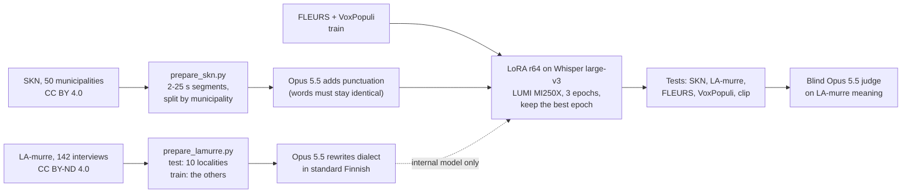

**1. Training text with punctuation.** SKN's standard-Finnish text has no punctuation and
almost no capitals, so round 1 learned to write almost none (1 of its 600 SKN test outputs has a
full stop or comma; base Whisper 97.5 %). [`prepare_targets.py`](scripts/prepare_targets.py)
had Claude Opus 5.5 add punctuation and capitals to every training and validation segment,
20 per call, and threw away any answer whose words were not exactly the input's: 15 024 of
15 042 passed, the other 18 kept their plain text. The text-only LLM never hears audio and
never touches a test set. The targets are in
[`results/labels/`](results/labels/skn_train.targets.jsonl).

**2. More dialect speech.** LA-murre's other recordings, without the 10 test localities, a
second recording from one of them and the five localities that are also SKN test
municipalities, give 15 532 segments (56 h). Their transcripts are in dialect spelling, so
Opus rewrote each one in standard Finnish, word for word; 15 529 kept a word count within 30 %
of the source. LA-murre is CC BY-ND, so the model trained on them is an internal comparison only
and its rewritten texts are not published.

**3. Training.** LoRA rank 64 on the attention query and value projections (2 % of the
weights), learning rate 1e-4, batch 8, on one MI250X. A four-epoch run showed overfitting:
validation loss was lowest after epoch 2 and rose after it (0.206, 0.208, 0.215), so the
final runs train three epochs and merge the epoch with the lowest validation loss, which
was epoch 2 in both. Published model: 25 250 segments, 3 h 8 min. Internal model:
40 779 segments, 4 h 57 min (training with per-epoch validation, from the `train_log.json` files).

| Model | Training data | SKN WER | LA-murre judge pts | FLEURS | VoxPopuli | Clip WER (chunked) | Clip Claude / Gemini pts |
|---|---|--:|--:|--:|--:|--:|--:|
| Whisper large-v3 | none | 40.4 | 25.9 | 7.4 | 12.7 | 15.7 | 1.7 / 5.5 |
| Round 1 (r32, 2 epochs) | SKN + open | 22.2 | 13.8 | 7.8 | 10.6 | 14.9 | 3.7 / 9.7 |
| **Round 2, published** | SKN with punctuation + open | 21.1 | 13.6 | **7.6** | 10.8 | **13.9** | 6.7 / 10.9 |
| Round 2, internal | + LA-murre rewritten | **19.7** | **11.4** | 7.8 | 11.4 | 15.9 | 3.0 / 6.2 |

WER in %, lower is better. LA-murre judge: meaning-error points per 100 reference words,
Claude Opus 5.5, all four models judged together on each of the 583 segments in shuffled,
unlabelled order (round 2 of [`judge_dialect.py`](scripts/judge_dialect.py)). Its scale
differs from the round-1 judging above, which compared other models: base Whisper gets 22.7
points in round 1 and 25.9 in round 2 (critical errors 41 and 74), the round-1 model 13.9 and
13.8. Compare models only within one round. The four-epoch variants are in
`results/benchmarks/*/scores.json` (`-r64e4`, `-punct`, `-lamurre`); their last epoch is slightly
better on SKN and worse on VoxPopuli.

**What it shows.**
- **Punctuation came back at no cost.** The published model writes punctuated sentences
  like base Whisper and is level with round 1 on dialects: SKN 21.1 against 22.2 % WER, and
  on LA-murre the judge cannot separate them (13.6 against 13.8 points; fewer points in 168
  segments, more in 138, sign test p = 0.10).
- **More dialect speech helps, and it carries over.** The internal model is best on both
  dialect tests: on LA-murre it has fewer points than round 1 in 234 segments and more in
  121 (p < 0.001), and fewer points than round 1 in all 10 localities; it is the lowest of the
  four models in 9 of them (the published model is lower in Muolaa, 12.1 against 13.1). Part of
  that is being trained on the same corpus as the test, though not on its localities. The published
  model cannot use this data under LA-murre's licence; a larger CC BY dialect corpus would be the way
  to get the same gain in a model that can be shared.
- **Names and terms on the webinar get worse with dialect training.** Every dialect model
  gets more meaning-error points on the clip than base Whisper. The published model has the
  lowest WER on the clip but gets 11 and 10 of 14 names right against 14 and 14 for base
  Whisper ("Nobelbayer" for Nobel Biocare, "Densplay-sirvana" for Dentsply Sirona); round 1
  matches base Whisper on Claude's name check (14 of 14) and trails by one on Gemini's. For webinar
  audio with brand names, base Whisper large-v3 remains the better choice; for dialect speech, ours.
- **Decode in chunks.** Whisper's own long-form loop made the round-2 models repeat one phrase over
  and over at the end of the clip (38.8 % WER for the four-epoch run, 62.7 % for the published
  model). Feeding 15–25 s chunks cut at quiet points (`run_open_models.py`, recipe `whisper_chunks`)
  removes it. The model card's table of decoding settings is the published model downloaded back
  from the Hub and run on the clip six ways
  ([`results/clip/decoding_check.json`](results/clip/decoding_check.json), scored by
  `score_asr.py --decoding` into [`decoding_scores.json`](results/clip/decoding_scores.json)):
  quiet-point pieces 13.7 % WER, the pipeline's `chunk_length_s=20` 14.7 %, `chunk_length_s=30`
  52.5 % (it loops) and 14.4 % with `no_repeat_ngram_size=6`; against the reviewed reference 13.5,
  13.5, 51.5 and 14.2 %.

**Cost.** Opus 5.5 for the training text, about 100 USD (punctuation 52, LA-murre rewriting
49); the blind judging of rounds 1 and 2 about 25 USD (round 3, for the timestamp variant below, used
about as many tokens as each of them); about 40 GCD-hours of LUMI GPU time for every job in both
rounds (about 20 billed GPU-hours). The published model (tag `v1.0`), its timestamp variant (branch
`timestamps`) and its SKN segments are on Hugging Face
([model](https://huggingface.co/GAIK-project/whisper-large-v3-fi-dialects),
[dataset](https://huggingface.co/datasets/GAIK-project/skn-finnish-dialects-asr)); their cards are
in [`release/`](release/) and [`publish_hf.py`](scripts/publish_hf.py) uploads them. The internal
LA-murre model is not published: it is kept in the private Hugging Face repository
GAIK-project/whisper-large-v3-fi-dialects-internal for use inside the project, and its rewritten
LA-murre training texts are not published either.

**Attribution.** SKN as above. LA-murre: Lauseopin arkiston murrekorpus, University of Turku
and Kotus, via Kielipankki, CC BY-ND 4.0, used for testing and for the internal model only.

## Timestamps and long-form audio

The published model was trained on text without Whisper's timestamp tokens. Does that break its
timestamps and its long-form decoding, and does training with them help?
[`eval_timestamps.py`](scripts/eval_timestamps.py) measured both against SKN's own sentence times
([`prepare_timestamps.py`](scripts/prepare_timestamps.py)):

- **Boundaries:** the 600 SKN test segments decoded with `return_timestamps=True`. For each of the
  791 sentence starts inside a segment (after its first sentence), the distance to the nearest
  timestamp the model wrote there.
- **Long-form:** from each of the 10 test municipalities about 4 minutes of one interview
  ([`results/labels/skn_longform.jsonl`](results/labels/skn_longform.jsonl), window edges in pauses
  no sentence crosses), decoded three ways: Whisper's own sequential long-form mode with timestamps;
  the same with OpenAI's temperature fallback (temperatures 0.0–1.0, compression-ratio threshold
  1.35, log-probability threshold −1.0, no-speech threshold 0.6, `condition_on_prev_tokens=False`),
  which decodes a 30 s window again at a higher temperature when its text compresses too well or its
  log-probability is too low; and 15–25 s pieces cut at the quietest 100 ms (the model card's code).
  A decode counts as a loop when one 5-word sequence occurs four times or more and more often than
  in the reference.

| Model | SKN sentence starts within 0.5 s / 1 s | Median distance | Long-form WER, sequential (loops) | Long-form WER, with fallback (loops) | Long-form starts within 1 s, with fallback | Long-form WER, pieces |
|---|--:|--:|--:|--:|--:|--:|
| Whisper large-v3 | 53.5 % / 60.8 % | 0.18 s | 37.5 % (0 of 10) | 37.5 % (0) | 62.6 % | 39.4 % |
| Published model | 0.8 % / 0.8 % | 5.33 s | 21.5 % (1 of 10) | 19.8 % (0) | 18.9 % | 17.3 % |
| Timestamp variant | 56.4 % / 57.8 % | 0.04 s | 25.2 % (3 of 10) | **18.1 %** (0) | 49.0 % | **17.1 %** |

The published model's timestamps are unusable: it writes them, but almost never where a sentence
starts. Its text is still good, and in pieces it is far ahead of base Whisper (17.3 % against
39.4 %). So decode it in pieces and take times from the cut points, as the model card's code does.
WER with timestamps on the short segments is 21.2 % (base 41.0 %), level with the scores above.
Results: [`results/timestamps/scores.json`](results/timestamps/scores.json), raw decodes beside it.

### The timestamp variant

Can training put the timestamps back? `finetune_whisper.py --timestamps 0.5` repeats the published
model's recipe, but half of the SKN items, drawn again every epoch, carry one timestamp pair per SKN
sentence (`<|0.00|> text<|1.84|>`, times from
[`results/labels/skn_parts.jsonl`](results/labels/skn_parts.jsonl)); 15 040 of the 15 042 training
items had usable times. Epoch 2 was kept, with validation loss 0.2158 (not comparable with the
published model's 0.206, because about half of its SKN validation segments carry timestamp tokens), after 3 h
6 min on one MI250X ([`train_log.json`](results/finetune/whisper-large-v3-fi-skn-punct-ts/train_log.json)).

| Test | Whisper large-v3 | Published model | Timestamp variant |
|---|--:|--:|--:|
| SKN dialect test, WER % | 40.4 | **21.1** | 21.4 |
| FLEURS, WER % | 7.4 | 7.6 | 7.4 |
| VoxPopuli, WER % | 12.7 | **10.8** | 11.2 |
| LA-murre, WER % (dialect reference) | 62.5 | 58.1 | 58.1 |
| LA-murre, blind judge round 3, points per 100 words | 24.2 | 13.7 | 13.7 |
| Clip, long-form with timestamps, WER % (HY's / reviewed reference) | 14.7 / 13.7 | 62.7 / 62.2 (loops) | 16.7 / 16.2 |
| Clip, quiet-point pieces, WER % (HY's / reviewed reference) | 15.7 / 15.7 | **13.9 / 14.0** | 15.2 / 14.5 |
| SKN sentence starts within 1 s | 60.8 % | 0.8 % | 57.8 % |
| Long-form interviews with fallback, WER % | 37.5 | 19.8 | **18.1** |

The blind judge's round 3 ([`judge_dialect.py`](scripts/judge_dialect.py) `--round r3`,
[`summary-r3.json`](results/judgements_dialect/lamurre_fi/summary-r3.json)) judged base Whisper, the
published model and the variant together on 577 of the 583 LA-murre segments: 24.18, 13.72 and 13.68
points. The variant has fewer points than the published model in 98 segments and more in 100 (sign
test p = 0.94): no difference.

**Decision.** The published model stays the main model. The rule set before the run was that the
variant replaces it only if SKN gets at most about 0.5 points worse, FLEURS and VoxPopuli get no
worse, and the timestamps are usable. VoxPopuli got 0.4 points worse, so the variant did not pass; the
clip in pieces was also 0.5–1.3 points worse. The variant is published as the `timestamps` revision of
[GAIK-project/whisper-large-v3-fi-dialects](https://huggingface.co/GAIK-project/whisper-large-v3-fi-dialects/tree/timestamps)
(card: [`release/TIMESTAMPS_CARD.md`](release/TIMESTAMPS_CARD.md)), and the main model is tagged
`v1.0`. Use the variant when you need sentence timestamps, or long audio transcribed without cutting
it yourself, and always with the fallback settings: without them it looped in 3 of the 10 interviews.

```python
import soundfile as sf
from transformers import pipeline

asr = pipeline(
    "automatic-speech-recognition",
    model="GAIK-project/whisper-large-v3-fi-dialects",
    revision="timestamps",
    dtype="float16",
    device="cuda",
)
audio, sr = sf.read("interview.wav", dtype="float32")  # 16 kHz mono, any length
out = asr(
    {"raw": audio, "sampling_rate": sr},
    return_timestamps=True,
    generate_kwargs={
        "language": "fi",
        "task": "transcribe",
        "temperature": (0.0, 0.2, 0.4, 0.6, 0.8, 1.0),
        "compression_ratio_threshold": 1.35,
        "logprob_threshold": -1.0,
        "no_speech_threshold": 0.6,
        "condition_on_prev_tokens": False,
    },
)
for chunk in out["chunks"]:
    print(f"[{chunk['timestamp'][0]:7.2f} s] {chunk['text'].strip()}")
```

## How far the LLM judges can be trusted

The judges are language models and they are noisy. On the clip, two arms with an identical
transcript, the Haaga-Helia WhisperX server's and HY's own run of the same set-up (a transcript HY
has not published, so it is not in this repository), got 4.5 and 3.5 points from Claude and 8.7 and
10.2 from Gemini, so read differences under about 2 points as ties. The same shows in this
repository on LA-murre: the same transcripts judged again in round 3, in other company and on 577 of
the 583 segments, got 24.2 instead of 25.9 points (base Whisper) and 13.7 instead of 13.6 (the
published model)
([`summary-r2.json`](results/judgements_dialect/lamurre_fi/summary-r2.json),
[`summary-r3.json`](results/judgements_dialect/lamurre_fi/summary-r3.json)). Gemini is stricter
throughout. Gemini also judges Gemini's own transcripts; Claude, which made no transcript, puts
Gemini 3.5 Flash first as well.

## Second opinions: open-model judges on CSC Aitta

Is the LA-murre result Claude's opinion only? Open models served by CSC's Aitta service (CSC's
OpenAI-compatible LLM API for Finnish research) judged round 2 again with the same prompt, answer
schema, labels and order as Claude ([`judge_dialect.py --provider aitta`](scripts/judge_dialect.py),
compared by [`judge_agreement.py`](scripts/judge_agreement.py) in
[`agreement-r2.json`](results/judgements_dialect/lamurre_fi/agreement-r2.json)):

| Judge | Segments | Whisper large-v3 | Round 1 | Published | Internal | Published vs base (fewer / more points) | Same preference as Claude |
|---|--:|--:|--:|--:|--:|--:|--:|
| Claude Opus 5.5 (reference) | 583 | 25.9 | 13.8 | 13.6 | 11.4 | 398 / 89 | – |
| gpt-oss-120b (Aitta) | 583 | 20.5 | 13.4 | 13.2 | 12.9 | 275 / 105 | 80.7 % of 1 535 pairs |
| Gemma 4 31B (Aitta), sample | 198 | 17.3 | 10.1 | 10.5 | 9.0 | 100 / 27 | 92.1 % of 544 pairs |
| Qwen3.6 27B (Aitta), sample | 197 | 23.0 | 11.8 | 11.3 | 9.3 | 121 / 27 | 92.8 % of 643 pairs |

Points are meaning-error points per 100 reference words. "Same preference" counts the pairs of
models in a segment where both judges see a difference, and how often they prefer the same one.
All four judges rank the models the same way: the internal model best, the published model and round
1 about level, base Whisper far behind; gpt-oss-120b also finds the published model clearly better
than base Whisper (sign test p < 0.001) and separates the three fine-tunes less than Claude does.
Gemma 4 31B and Qwen3.6 27B were run on a sample, not on all 583 segments: both judged the same seeded
sample of 200 segments (`--per-locality 20`: 20 per locality, seed 0; Gemma answered 198, Qwen 197),
and Gemma puts round 1 just ahead of the published model. Point scales differ between judges, so compare
models within one judge.

## Dialect data and next steps

This clip cannot say how the models handle dialects. What it does show is the method:
a dialect test needs dialect audio with a transcript a person has checked, and a
decision on whether the transcript should keep the dialect forms or normalise them,
because WER punishes whichever the model does not do. The LLM judge is built to ignore
that difference and count only meaning.

Data that could serve as a dialect test set and as fine-tuning data:

| Dataset | What | Access |
|---|---|---|
| Lahjoita puhetta (Donate Speech) | About 3 600 h of spontaneous Finnish from over 20 000 speakers across Finland, part of it transcribed, with dialect metadata | Kielipankki; licence agreement, a fee for commercial use |
| Suomen kielen näytteitä (SKN) | Dialect recordings from 50 localities, with both dialect and normalised transcripts | Kielipankki, CC BY 4.0: **used here** for the dialect test and fine-tune |
| Lauseopin arkiston murrekorpus (LA-murre) | 142 dialect samples from 132 localities, dialect transcripts only | Kielipankki, CC BY-ND 4.0: **used here** as the second dialect test and for the internal model |
| Common Voice, FLEURS, VoxPopuli (Finnish) | Read or formal speech, the sets the RASMUS model card reports | Open |

What was held out: the published model trained on all of the 38 training municipalities' segments.
The 2 validation and 10 test municipalities stayed out of training entirely, and the test uses 60
segments from each test municipality, so the rest of those 12 interviews (4 601 segments, 19.5 h) was
not used at all.

What was tried next (15 Oct 2026):

1. **All of SKN.** The same recipe on all 50 municipalities (19 643 segments, about 81 h; validation
   on FLEURS and VoxPopuli only), tested on what it had not heard. On LA-murre the blind judge
   (Claude Opus 5.5, all six models of the fourth round together, 583 segments) gives it 13.1 points
   against the published model's 14.2: fewer points in 177 segments and more in 114 (sign test
   p = 0.0003). FLEURS stays level (7.5 against 7.6 %), VoxPopuli gets worse (11.9 against 10.8 %),
   and on the ten dental webinars the judges see no difference (4.8 / 9.6 against 5.1 / 10.0 points).
   The rule set before the run allowed FLEURS and VoxPopuli at most 0.5 points worse, so it did not
   replace the published model; it is on the model's
   [`all-skn` branch](https://huggingface.co/GAIK-project/whisper-large-v3-fi-dialects/tree/all-skn)
   ([card](release/ALL_SKN_CARD.md)) for audio that is mostly dialect.
2. **How well Opus rewrites dialect.** The prompt that turned LA-murre's dialect transcripts into
   standard Finnish for the internal model, run on SKN's dialect transcripts of the 600 test segments
   and scored against SKN's human standard-Finnish text: 14.2 % WER, so the internal model's training
   text is close to, not the same as, a person's normalisation.
3. **The API services on the dialect test.** gpt-4o-transcribe (through GAIK's Azure) leaves out 46 %
   of the dialect test's words (62.5 % WER) and gets the most meaning-error points on LA-murre (34.2);
   ElevenLabs Scribe v2 gets 44.9 % on SKN. Every service and model ran on FLEURS and VoxPopuli as
   well ([table](#public-test-sets-skn-and-la-murre-dialects-fleurs-and-voxpopuli)).

Still open:

1. **LA-murre for the published model.** Permission to publish a model trained on LA-murre's
   standard-Finnish rewrites has been asked from the rightholders (University of Turku and Kotus,
   via FIN-CLARIN).
2. **Today's speech.** Both dialect corpora are 1960s–70s interviews. Lahjoita puhetta (Donate
   Speech, about 3 200 h of everyday Finnish from all regions) would test present-day speech; it is
   CLARIN RES and needs a research plan and the project's public privacy notice.
3. **Names and terms.** Spontaneous standard Finnish with brand names and terms, the kind of speech
   the webinar clips have, where every dialect fine-tune here is weaker than base Whisper.
4. **Checked dental references.** HY's transcripts of the ten dental clips leave fillers out and were
   not checked by a listener; a reviewed version would make their word error rates meaningful.

## What's in this folder

| Path | What it holds |
|---|---|
| [`scripts/`](scripts/) | Runners, scorer, judges, table and chart builders (see [Run it again](#run-it-again)). [`provenance.py`](scripts/provenance.py) writes each run's `_run_metadata*.json`; [`asr_scoring.py`](scripts/asr_scoring.py) is the clip scorer with HY's normalisation; [`get_clip.py`](scripts/get_clip.py) fetches the clip. |
| [`tests/`](tests/) | Offline tests (`uv run pytest`): no keys, no downloads, no GPU. |
| [`lumi/`](lumi/) | How the open models were run and trained on LUMI: environment setup, Slurm jobs, and stubs that hide three container libraries NeMo cannot use. |
| [`release/`](release/) | The Hugging Face cards, uploaded by [`publish_hf.py`](scripts/publish_hf.py): [`MODEL_CARD.md`](release/MODEL_CARD.md) (the main model), [`TIMESTAMPS_CARD.md`](release/TIMESTAMPS_CARD.md) (its `timestamps` revision), [`ALL_SKN_CARD.md`](release/ALL_SKN_CARD.md) (its `all-skn` revision) and [`DATASET_CARD.md`](release/DATASET_CARD.md). |
| [`docs/`](docs/) | [`DIALECT-EXAMPLES.md`](docs/DIALECT-EXAMPLES.md) (20 SKN test segments side by side and WER per municipality), [`story/`](docs/story/) (the walk-through pages, one self-contained HTML file per language, built from `story/src/`) and [`img/`](docs/img/) (the dialect chart from `dialect_chart.py`, the front page's figures from [`readme_figures.py`](scripts/readme_figures.py), the banner, an AI illustration made with GPT Image 2.5, and the sources' logos in `logos/`, their owners' trademarks, from [svgl](https://svgl.app/)). [`video/`](docs/video/) holds the front page's 21-second video: shots made with Runway Gen-4.5 and music with ElevenLabs Music (both through Replicate), no people, no voice. The story pages are also served at [gaik-project.github.io/finnish-asr](https://gaik-project.github.io/finnish-asr/). |
| [`results/transcriptions/`](results/transcriptions/) | One JSON per model and run on the clip: transcript, settings, library versions, timing. [`qad1/`](results/transcriptions/qad1/) holds GAIK's earlier QAD-1 runs (OpenAI, Gemini, the gaik transcriber, the Haaga-Helia WhisperX server, Whisper on CSC Roihu). |
| [`results/judgements/`](results/judgements/) | Per judge and model: every meaning error quoted from the reference and the transcript, the name checks, reference doubts, scores. |
| [`results/scores.json`](results/scores.json), [`scores.reviewed.json`](results/scores.reviewed.json) | WER, CER and error counts for every clip transcript, against HY's and the reviewed reference. |
| [`results/clip/`](results/clip/) | [`gt_alignment.json`](results/clip/gt_alignment.json): the reference's sentences, word times and QAD-1's 42 reference doubts, frozen from QAD-1 for the listening page. [`decoding_check.json`](results/clip/decoding_check.json) and [`decoding_scores.json`](results/clip/decoding_scores.json): the published model from the Hub decoded six ways, the model card's settings table. |
| [`results/benchmarks/`](results/benchmarks/) | SKN, FLEURS and VoxPopuli: one line per recording (reference, transcript, seconds) and `scores.json`. LA-murre: `scores.json` and run metadata only. |
| [`results/judgements_dialect/`](results/judgements_dialect/) | The LA-murre meaning judges: `summary*.json` (rounds 1–3 and the Aitta judge), `agreement-r2.json` and run metadata (numbers only). |
| [`results/finetune/`](results/finetune/) | The training log of every fine-tune: per-epoch validation loss, data counts, the epoch kept. No weights. |
| [`results/labels/`](results/labels/) | SKN training targets with LLM punctuation, SKN sentence times per segment, the long-form windows; for LA-murre only the statistics. |
| [`results/timestamps/`](results/timestamps/) | Raw decodes with timestamps and long-form windows (base Whisper, the published model, the timestamp variant), and their scores. |
| [`results/gpu_run/`](results/gpu_run/) | GPU, host and library versions of the last clip job per environment (hf, nemo, qwen) on LUMI. |

Not here, on purpose: the clip and its references (download them from gaik-toolkit with
`get_clip.py`; `data/` is gitignored), any LA-murre text (per-segment benchmark files, judge records,
rewritten training texts: licence), HY's own tool transcripts (not public), model weights (the
published model is on Hugging Face) and LUMI job logs. The LA-murre outputs the public scripts can
regenerate are listed in [`.gitignore`](.gitignore).

## How it works

**Input.** Every model gets the same 180 s file with Finnish set as the language where
the model takes one, and no prompt or word list. Whisper and Qwen3-ASR take the whole
clip. Models limited to short audio (Canary, Parakeet, Orukeet, wav2vec2, Chirp 3)
get the same eight chunks, cut at the quietest 100 ms between 15 and 25 s.

**WER and CER.** The scorer of QAD-1 and the toolkit's transcription_eval, with HY's normalisation,
vendored in [`asr_scoring.py`](scripts/asr_scoring.py) and unchanged, so the numbers match HY's and
QAD-1's published ones. The public test sets use the usual model-card normalisation (lower-case,
punctuation removed, whitespace collapsed) and corpus-level WER ([`score_benchmark.py`](scripts/score_benchmark.py)).

**LLM judges on the clip.** Claude Opus 5.5 and Gemini 3.1 Pro each read the reference and one
transcript, without the model's name ([`judge_asr.py`](scripts/judge_asr.py)). The prompt tells them
to report only what would mislead a reader: a wrong word, name or number, missing content, invented
content. Fillers, spoken against written forms, compound spacing, punctuation and digits
against number words are explicitly not errors. Each judge also checks 14 names and
terms against their correct spelling (the reference itself misspells Dentsply Sirona)
and lists places where the reference looks wrong; those are reported, not scored.

**SKN data and training.** `prepare_skn.py` cuts SKN by municipality (2–25 s, seed 0);
`prepare_targets.py punct` adds LLM punctuation and keeps an answer only if its words are identical;
[`finetune_whisper.py`](scripts/finetune_whisper.py) trains a LoRA adapter on LUMI in a plain PyTorch
loop and keeps the epoch with the lowest validation loss.

**The LA-murre judge.** `judge_dialect.py` gives one judge the dialect reference and every model's
transcript of a segment at once, labelled with letters in an order shuffled per segment, and counts
meaning errors only. Rounds judge different sets of models (round 1: base Whisper, round 1's model,
Finnish-NLP; round 2: base Whisper and our three round-1 and round-2 models; round 3: base Whisper,
the published model and the timestamp variant); `--provider aitta` runs the same judgement on an open
model on CSC Aitta, and `judge_agreement.py` compares judges segment by segment. The
published scores were made with prompt `dialect-judge-v1`; this repository's copy is `v2`, identical
except that its three example word pairs come from SKN instead of LA-murre (the docstring explains).

**Timestamps.** `prepare_timestamps.py` turns SKN's sentence annotation into sentence times inside
every published segment and into the 10 long-form windows; `finetune_whisper.py --timestamps 0.5`
trains with them; `eval_timestamps.py` decodes on LUMI (`--fallback` adds the temperature-fallback
decode) and scores locally.

**Decoding settings.** `score_asr.py --decoding` scores the published model's six decodings of the
clip in `results/clip/decoding_check.json` against both references; the model card's table of
settings to avoid comes from it.

**Provenance.** Every runner that writes results writes a secret-free `_run_metadata*.json` beside
them: commit, runner, dataset path, models, arguments, and which keys were set (never their values).
Files made before this repository existed carry `gaik_evals_commit` and paths of GAIK's private
evaluation repository, where the work was first done; their content is unchanged.

**Where it ran.** Open models and training: one GPU on LUMI (AMD MI250X) in CSC's PyTorch
container. ElevenLabs, Chirp 3, OpenAI and Gemini: their APIs. LLM judges: Claude through Azure
Foundry, Gemini through Vertex AI, open models through CSC Aitta.

## Run it again

From the repo root, with [uv](https://docs.astral.sh/uv/):

```bash
uv sync --all-extras                                  # Python deps for every local step
uv run pytest                                         # offline tests: no keys, no downloads, no GPU
uv run python scripts/get_clip.py --prepare-audio     # the clip and both references from gaik-toolkit (ffmpeg on PATH)

# the clip: API models, scores, judges, the README table
uv run python scripts/run_api_asr.py --repeats 3      # ElevenLabs, Chirp 3
uv run python scripts/score_asr.py                    # WER/CER, no keys; --reviewed for the reviewed reference
uv run python scripts/score_asr.py --decoding         # the model card's decoding-settings table
uv run python scripts/judge_asr.py                    # both judges (--claude-provider api for an Anthropic key)
uv run python scripts/make_readme_table.py            # the clip table above

# open models, public test sets and training on LUMI, one wrapper for every step (details: lumi/README.md)
export LUMI_USER=<your CSC user name> LUMI_PROJECT=project_<number>
L=lumi/lumi.sh
bash $L push && bash $L setup && bash $L download clip && bash $L download bench   # once
for e in hf qwen nemo; do bash $L run clip $e; bash $L run bench $e; done            # six jobs
bash $L status                                                                       # until the queue is empty
bash $L fetch
uv run --extra api-asr --extra judges --extra hub python scripts/run_api_benchmark.py \
  --arm vertex_gemini-3.5-flash --arm vertex_gemini-3.5-flash-std --arm google_chirp-3   # Gemini 3.5 Flash (two prompts), Chirp 3 on SKN
uv run python scripts/score_benchmark.py              # SKN/FLEURS/VoxPopuli table, no keys

# the dialect model: SKN, punctuated targets, training, its tests
bash $L download skn && bash $L prepare skn
bash $L fetch-labels                                  # prepare_skn.py's segment lists -> results/labels/ (gitignored)
uv run python scripts/prepare_targets.py punct results/labels/skn_train.jsonl
bash $L push-labels && bash $L download train
bash $L run train hf --name whisper-large-v3-fi-skn-punct-best --data skn+open --skn-text punct --epochs 3 --lora-r 64
bash $L run clip hf --arm ft_whisper-large-v3-fi-skn-punct-best-chunks
bash $L run bench hf --bench skn_fi && bash $L fetch
uv run python scripts/dialect_chart.py                # docs/img/dialect-finetune.svg, no keys
uv run python scripts/dialect_examples.py             # docs/DIALECT-EXAMPLES.md, no keys
uv run python scripts/build_story.py                  # docs/story/story.{en,fi}.html, no keys
uv run python scripts/readme_figures.py              # the front page's figures in docs/img/, no keys
uv run --extra hub python scripts/build_listen.py    # docs/listen.html and its SKN clips, no keys
uv run python scripts/build_compare.py                # results/compare.html (gitignored); fetches the SKN test parquet

# timestamps and long-form (prepare_timestamps.py needs SKN's *_full.eaf files)
uv run python scripts/prepare_timestamps.py <dir with SKN *_full.eaf>
bash $L push-labels && bash $L run timestamps hf --arm hf_whisper-large-v3 --arm hub_whisper-large-v3-fi-dialects

# the timestamp variant: training, its tests, and the timestamp evaluation with the fallback decode
bash $L run train hf --name whisper-large-v3-fi-skn-punct-ts --data skn+open --skn-text punct --epochs 3 --lora-r 64 --timestamps 0.5
bash $L run clip hf --arm ft_whisper-large-v3-fi-skn-punct-ts --arm ft_whisper-large-v3-fi-skn-punct-ts-chunks
for b in skn_fi fleurs_fi voxpopuli_fi; do bash $L run bench hf --bench $b --arm ft_whisper-large-v3-fi-skn-punct-ts; done
bash $L run timestamps hf --arm ft_whisper-large-v3-fi-skn-punct-ts
bash $L run timestamps hf --fallback --arm hf_whisper-large-v3 --arm hub_whisper-large-v3-fi-dialects --arm ft_whisper-large-v3-fi-skn-punct-ts
bash $L fetch && uv run python scripts/eval_timestamps.py score

# LA-murre (CC BY-ND): downloaded from Kielipankki; every per-segment output stays local (gitignored)
bash $L prepare lamurre && bash $L run bench hf --bench lamurre_fi && bash $L fetch
uv run python scripts/judge_dialect.py --round r2 --arms hf_whisper-large-v3,ft_whisper-large-v3-fi-skn,ft_whisper-large-v3-fi-skn-punct-best,ft_whisper-large-v3-fi-skn-lamurre-best
uv run python scripts/judge_dialect.py --round r2 --arms <the same> --provider aitta --judge-model openai/gpt-oss-120b
uv run python scripts/judge_agreement.py --round r2
uv run python scripts/judge_dialect.py --round r3 --arms hf_whisper-large-v3,ft_whisper-large-v3-fi-skn-punct-best,ft_whisper-large-v3-fi-skn-punct-ts

# the API services on every test set (FLEURS, VoxPopuli and LA-murre WAVs: bash $L fetch-audio <bench>)
for b in skn_fi fleurs_fi voxpopuli_fi lamurre_fi; do uv run --extra api-asr python scripts/run_api_benchmark.py   --bench $b --arm azure_gpt-4o-transcribe --arm elevenlabs_scribe-v2 --arm google_chirp-3; done

# all of SKN: every segment of the 12 held-out municipalities joins the training data
bash $L prepare skn-heldout && bash $L fetch-labels
uv run python scripts/prepare_targets.py punct results/labels/skn_heldout.jsonl && bash $L push-labels
bash $L run train hf --name whisper-large-v3-fi-skn-all --data skn-all+open --skn-text punct --epochs 3 --lora-r 64
for b in fleurs_fi voxpopuli_fi lamurre_fi; do bash $L run bench hf --bench $b --arm ft_whisper-large-v3-fi-skn-all; done
uv run python scripts/judge_dialect.py --round r4 --arms hf_whisper-large-v3,ft_whisper-large-v3-fi-skn-punct-best,ft_whisper-large-v3-fi-skn-all,ft_whisper-large-v3-fi-skn-lamurre-best,azure_gpt-4o-transcribe,vertex_gemini-3.5-flash-std
uv run python scripts/judge_dialect.py --round r4 --arms <the same> --provider aitta --judge-model openai/gpt-oss-120b   # Gemma 4 and Qwen3.6: --per-locality 20

# the ten dental-webinar clips (HY's private references in data/dental10/, gitignored)
bash $L push-dental && bash $L run clip hf --bench dental10_fi
uv run --extra judges python scripts/judge_dental.py   # blind judges; only summary.json is committed
```

Each step skips what it has already done; `--force` redoes it (`bash $L run clip hf --force`).
To add a model, add a line to `ARMS` in `run_open_models.py` and `run_benchmark.py`
and run `push`, `download` and `run` for its environment. `bash $L clean` removes the
project from LUMI's scratch when the work is over. Keys go in a `.env` at the repo root;
[`.env.example`](.env.example) lists their names per script. `publish_hf.py` needs a GAIK-project
write token and is for maintainers.

## Caveats

- **One 180-second clip.** It separates usable from unusable models and shows where WER
  misleads. It cannot rank models that are close, and it says nothing about dialects,
  noise or phone audio.
- **The judges are AI models and they are noisy**; read clip differences under about 2 points as
  ties ([How far the LLM judges can be trusted](#how-far-the-llm-judges-can-be-trusted)).
- **The reference is reviewed only at its 42 disputed spans.** On 14 Oct 2026 a listener checked
  them and corrected 14 (gaik-toolkit's `reference.reviewed.txt`; see
  [Reviewed reference](#reviewed-reference)); the rest is HY's unverified text. The judges flag
  0–3 reference doubts per transcript.
- **Each open model ran once**, with greedy or default decoding. The Finnish-NLP
  wav2vec2 model ran without its KenLM language model (it would not build in the
  container), which costs it accuracy. The RASMUS model ran with this project's energy
  chunking, not its own VAD or diarisation pipeline.
- **Speed was not measured on the clip**: the recorded times include model loading.
- **The SKN test shares SKN's conventions.** Test municipalities are never heard in
  training, but the recordings, interviewers' style and transcription conventions are
  SKN's own, which favours the model trained on SKN; the LA-murre test does not have
  that problem but is scored by model judges. Both corpora are 1960s–70s interviews
  with elderly speakers, not today's regional speech. The other models were not given SKN's
  conventions (for example, numbers written as words), which costs them some WER.
  Each fine-tune was trained once with one seed; read gaps of about 1 point per 100 words on
  LA-murre as ties unless the sign test says otherwise.
- **The LA-murre numbers cannot be checked from this repository alone.** No LA-murre text is here;
  rebuilding the test from Kielipankki (`prepare_lamurre.py`) and rerunning the models and the judge
  reproduces them. The public judge prompt differs from the one that made them in three example
  word pairs.
- **Two of the Aitta judges saw only a sample.** gpt-oss-120b judged all 583 segments; Gemma 4 31B
  and Qwen3.6 27B a seeded sample of 200 (198 and 197 answered), so their numbers carry more sampling noise.
- **The timestamp results rest on SKN's own sentence times and ten 4-minute windows**, and the
  timestamp variant, like every fine-tune here, was trained once with one seed.
- **The training texts are partly LLM-written.** Punctuation (SKN) and standard spellings
  (LA-murre, internal model) come from Opus 5.5 with a word-level check, not from a person. The tests
  are not touched: their references are the corpora's human transcripts.
- **Older provenance points to a private repository.** Result files made before this repository
  existed record `gaik_evals_commit` and paths in GAIK's private evaluation repository, where the work
  was first done.

## Licences, attribution and credits

- **Code** (`scripts/`, `tests/`, `lumi/`): MIT, [`LICENSE`](LICENSE), copyright Haaga-Helia
  University of Applied Sciences (GAIK project).
- **Results, figures and documentation created by the GAIK project** (scores, judge records,
  training logs and model transcripts in `results/`, the chart, the story pages and these texts):
  [CC BY 4.0](https://creativecommons.org/licenses/by/4.0/). Credit: GAIK project, Haaga-Helia
  University of Applied Sciences.
- **Data from other sources keep their licences:**
  - **Suomen kielen näytteitä (SKN)**, Kotimaisten kielten keskus (Kotus), via Kielipankki – The
    Language Bank of Finland, [urn:nbn:fi:lb-2020112937](http://urn.fi/urn:nbn:fi:lb-2020112937),
    [CC BY 4.0](https://creativecommons.org/licenses/by/4.0/). Changes: cut into 2–25 s segments;
    punctuation and capitals added to the training and validation targets by Claude Opus 5.5 (words
    unchanged).
  - **FLEURS**, Google, [google/fleurs](https://huggingface.co/datasets/google/fleurs),
    [CC BY 4.0](https://creativecommons.org/licenses/by/4.0/). Conneau et al., "FLEURS: Few-shot
    Learning Evaluation of Universal Representations of Speech", IEEE SLT 2022
    ([arXiv:2205.12446](https://arxiv.org/abs/2205.12446)).
  - **VoxPopuli**, Meta, [facebook/voxpopuli](https://huggingface.co/datasets/facebook/voxpopuli),
    [CC0 1.0](https://creativecommons.org/publicdomain/zero/1.0/). Wang et al., "VoxPopuli: A
    Large-Scale Multilingual Speech Corpus for Representation Learning, Semi-Supervised Learning and
    Interpretation", ACL 2021 ([arXiv:2101.00390](https://arxiv.org/abs/2101.00390)).
  - **Lauseopin arkiston murrekorpus (LA-murre)**, University of Turku and Kotus, via Kielipankki,
    [urn:nbn:fi:lb-2020112935](http://urn.fi/urn:nbn:fi:lb-2020112935),
    [CC BY-ND 4.0](https://creativecommons.org/licenses/by-nd/4.0/): the test set for every model
    here; only the internal model, which is not published, was also trained on it (other
    localities). No LA-murre text is in this repository, only numbers made from it.
- **Model weights**: the published model and its `timestamps` revision are
  [Apache 2.0](https://www.apache.org/licenses/LICENSE-2.0), as the base model
  openai/whisper-large-v3; the published dataset is CC BY 4.0.
- **The Ajokortti clip** is an excerpt of a public QAdental webinar; QAdental (Suomen
  Kotilääkäripalvelu Oy) is a GAIK project partner. The audio is not stored here and is not covered
  by this repository's licences; [`get_clip.py`](scripts/get_clip.py) downloads it, with its
  reference transcripts (by the University of Helsinki team, and the reviewed one), from
  [gaik-toolkit](https://github.com/GAIK-project/gaik-toolkit/tree/main/evaluation_layer/eval_methods/transcription_eval),
  where they are public.
- **Story pages**: the illustration is AI-generated (GPT Image 2.5), the two audio clips are SKN
  segments (CC BY 4.0), and the icons are [Lucide](https://lucide.dev/) (ISC licence); the database
  and link icons are derived from [Feather](https://feathericons.com/) (MIT licence).

Details in [`NOTICE.md`](NOTICE.md).

Developed by Akseli Leskinen ([laguagu](https://github.com/laguagu)), Haaga-Helia University of
Applied Sciences, in the [GAIK project](https://gaik.ai/) (Generative AI-enhanced Knowledge
Management in Business), led by Haaga-Helia with the University of Helsinki and Tampere University,
co-funded by the European Union (ERDF). The Ajokortti reference transcript was made by the University
of Helsinki team.

**LUMI.** We acknowledge CSC – IT Center for Science, Finland for awarding this project access to
the LUMI supercomputer, owned by the EuroHPC Joint Undertaking, hosted by CSC (Finland) and the LUMI
consortium through CSC – IT Center for Science, Finland.
