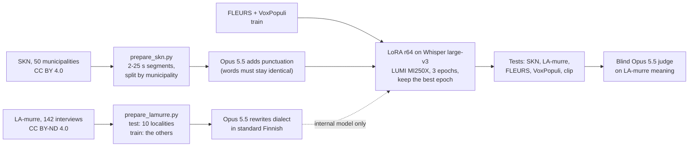

# Finnish speech-to-text: 20+ models compared, and a Whisper fine-tune for dialects

Organisations ask whether there are speech-to-text models that understand Finnish, dialects
included, and can run locally. This repository runs 20 current speech-to-text set-ups, 12 of them
open models that run on your own GPU, on one Finnish webinar clip and scores them two ways: word
error rate, and two blind LLM judges that count only the errors that change the meaning. It then
measures the open models on four public test sets, two of them dialect corpora, and fine-tunes
Whisper large-v3 for Finnish dialects: that model and its training data are published on Hugging
Face.

🤗 [Model: GAIK-project/whisper-large-v3-fi-dialects](https://huggingface.co/GAIK-project/whisper-large-v3-fi-dialects) ·
🗂️ [Dataset: GAIK-project/skn-finnish-dialects-asr](https://huggingface.co/datasets/GAIK-project/skn-finnish-dialects-asr) ·
🧰 [gaik-toolkit](https://github.com/GAIK-project/gaik-toolkit) ·
🌐 [gaik.ai](https://gaik.ai/)

Developed by Akseli Leskinen ([laguagu](https://github.com/laguagu)), Haaga-Helia University of
Applied Sciences, in the [GAIK project](https://gaik.ai/), co-funded by the European Union (ERDF).

The clip is **Ajokortti**: 180 s of a Finnish dental-education webinar, two speakers, standard
spoken Finnish with many names and brand names. It and the University of Helsinki (HY) team's
reference transcript are published in gaik-toolkit's
[transcription_eval](https://github.com/GAIK-project/gaik-toolkit/tree/main/evaluation_layer/eval_methods/transcription_eval);
[`get_clip.py`](scripts/get_clip.py) downloads them from there, they are not copied here. Some
transcripts come from **QAD-1**, GAIK's earlier re-run of HY's evaluation of this clip. The clip is
**not dialect speech**: dialects are measured on held-out parts of two dialect corpora
([Public test sets](#public-test-sets-skn-and-la-murre-dialects-fleurs-and-voxpopuli),
[Our dialect model](#our-dialect-model)).

## TL;DR

- 🏆 **Fewest meaning errors: Gemini 3.5 Flash**, first for both judges. Next come
  Google Chirp 3, ElevenLabs Scribe v2 and, as the best open models, plain **Whisper
  large-v3** and **large-v3 turbo**; the judges order those four differently.
- 📏 **WER ranks the models differently.** The Finnish-NLP Whisper fine-tune has the
  lowest WER (11.9 %) but more meaning errors than base Whisper large-v3 (14.7 %): it
  garbles brand names ("Nobel-Baker", "Kamloch-Konelloch"). ElevenLabs has a WER of
  18.2 % but only 5 minor errors for Claude, because it writes what was said ("mä", "semmonen")
  where the reference has standard forms. The reference also looks like a corrected
  WhisperX draft, which favours Whisper-family output on WER.
- 👂 **A listener's review of the reference confirms it.** After the 42 spans most systems
  disputed were checked by ear (14 corrected), the WhisperX lead disappears and the leading set
  sits within about one point, 13.2–14.2 % WER ([Reviewed reference](#reviewed-reference)).
- 🖥️ **Local and good enough: Whisper large-v3 or large-v3 turbo.** Every other open
  model is clearly behind on this clip: Orukeet, RASMUS Finnish Canary, Canary 1B v2,
  Parakeet v3 and wav2vec2 at 22–32 % WER.
- ❌ **Qwen3-ASR is not usable for Finnish**: 58 % WER (1.7B) and 78 % (0.6B), although
  Finnish is on its language list.
- 🇫🇮 **The Finnish Canary fine-tune did not beat its base on names.** RASMUS
  Finnish-ASR-Canary-v2 scores 22–24 % WER against 24 % for NVIDIA's Canary 1B v2, and
  gets fewer of the 14 names right (7–11 against 10–13). Its model card reports 4.6 %
  on Common Voice: read speech, not a webinar.
- 🗣️ **Dialects: every model struggles, and fine-tuning on dialect data nearly halves
  the errors.** On 600 dialect segments from 10 municipalities no model had heard, the
  best ready-made model (Whisper large-v3) has 40 % WER and the Finnish fine-tunes
  48–57 %. A LoRA fine-tune of Whisper large-v3 on 62 h of open dialect interviews
  (SKN, CC BY 4.0) brings it to **22 %**, better in all 10 municipalities, with FLEURS
  and VoxPopuli kept about level. A second, independent dialect corpus (LA-murre, 10
  other localities) confirms it on meaning: a blind judge gives the fine-tune 13.8
  meaning-error points per 100 words against 25.9 for base Whisper (round-2 judging),
  better in all 10 localities.
- 🛠️ **Our own model, round 2: punctuation back, and more dialect speech helps.** An LLM
  added punctuation to the training text (round 1 wrote none), and a second run added
  56 h of LA-murre interviews rewritten in standard Finnish. The published model keeps
  round 1's dialect accuracy (SKN 21.1 % WER, judge 13.6 against base Whisper's 25.9) and
  writes sentences. The internal one with LA-murre is the best on both dialect tests
  (19.7 %, 11.4 points), but LA-murre's no-derivatives licence keeps it private. On the webinar
  clip all of them spell rare names and dental terms worse than base Whisper
  ([Our dialect model](#our-dialect-model)).
- ⚖️ **An open judge agrees.** gpt-oss-120b on CSC's Aitta service, given the same blind task on
  all 583 LA-murre segments, puts the four models in Claude's order and gives the published model
  fewer points than base Whisper in 275 segments, more in 105
  ([How far the LLM judges can be trusted](#how-far-the-llm-judges-can-be-trusted)).
- ⏱️ **Do not trust the fine-tune's own timestamps; decode it in pieces.** Only 0.8 % of SKN
  sentence starts get a timestamp from it within 0.5 s (base Whisper: 53.5 %). On ten 4-minute
  dialect recordings, 15–25 s pieces cut at quiet points give 17.3 % WER against 21.5 % for
  Whisper's own long-form mode, which looped once
  ([Timestamps and long-form audio](#timestamps-and-long-form-audio)).
- 🤗 **Published 13 Oct 2026:** the model
  [GAIK-project/whisper-large-v3-fi-dialects](https://huggingface.co/GAIK-project/whisper-large-v3-fi-dialects)
  (Apache 2.0) and its SKN segments
  [GAIK-project/skn-finnish-dialects-asr](https://huggingface.co/datasets/GAIK-project/skn-finnish-dialects-asr)
  (CC BY 4.0). This repository holds the method, the code and the results behind them.

<!-- readme-table:start -->
| Model | Type | WER % | CER % | Claude pts | Gemini pts | Names (Claude / Gemini) |
|---|---|--:|--:|--:|--:|--:|
| Gemini 3.5 Flash | API | 14.2 (14.2–17.9) | 5.0 | 0.8 | 1.2 | 14 / 14 of 14 |
| Google Chirp 3 | API | 19.6 | 6.6 | 1.2 | 3.7 | 14 / 11 of 14 |
| Whisper large-v3, chunked decoding | open | 15.7 | 6.7 | 1.7 | 5.5 | 14 / 14 of 14 |
| Whisper large-v3 | open | 14.7 | 6.0 | 2.7 | 5.2 | 14 / 13 of 14 |
| ElevenLabs Scribe v2 | API | 18.2 (17.2–18.4) | 4.9 | 1.2 | 7.0 | 14 / 12 of 14 |
| This project, round 2 internal (+ LA-murre), chunked | open | 15.9 | 4.7 | 3.0 | 6.2 | 14 / 12 of 14 |
| Whisper large-v3 turbo | open | 18.4 | 7.7 | 1.5 | 8.5 | 14 / 13 of 14 |
| This project's pilot: Whisper large-v3 + LoRA on FLEURS and VoxPopuli | open | 17.9 | 8.3 | 2.2 | 8.2 | 14 / 13 of 14 |
| OpenAI gpt-transcribe | API | 18.4 (18.4–19.1) | 8.5 | 4.2 | 8.5 | 12 / 12 of 14 |
| WhisperX + Finnish-NLP whisper-large-finnish-v3 (Haaga-Helia WhisperX server) | open | 11.9 | 3.5 | 4.5 | 8.7 | 13 / 11 of 14 |
| This project, round 1, chunked decoding | open | 14.9 | 5.3 | 3.7 | 9.7 | 14 / 13 of 14 |
| OpenAI gpt-4o-transcribe | API | 16.9 (16.2–18.4) | 6.7 | 6.0 | 7.5 | 11 / 10 of 14 |
| OpenAI whisper-1 | API | 23.1 | 11.2 | 3.0 | 10.4 | 14 / 14 of 14 |
| Finnish-NLP whisper-large-finnish-v3 (plain transformers) | open | 13.2 | 4.3 | 5.2 | 8.5 | 13 / 11 of 14 |
| This project, round 1: Whisper large-v3 + LoRA on SKN dialects, FLEURS and VoxPopuli | open | 17.9 | 5.6 | 4.5 | 9.4 | 13 / 12 of 14 |
| OpenAI gpt-4o-mini-transcribe | API | 13.9 (13.9–14.7) | 4.4 | 3.2 | 11.4 | 13 / 10 of 14 |
| Orukeet (Parakeet v3 fine-tune) | open | 26.4 | 10.2 | 6.2 | 10.7 | 13 / 11 of 14 |
| This project, round 2 (publishable), chunked decoding | open | 13.9 | 5.2 | 6.7 | 10.9 | 11 / 10 of 14 |
| RASMUS Finnish-ASR-Canary-v2, greedy | open | 23.9 | 8.1 | 6.5 | 13.7 | 11 / 8 of 14 |
| RASMUS Finnish-ASR-Canary-v2 + KenLM | open | 22.1 | 8.5 | 8.5 | 15.4 | 11 / 7 of 14 |
| Gemini 3.1 Pro | API | 22.4 (15.4–22.4) | 9.3 | 7.0 | 18.4 | 12 / 10 of 14 |
| NVIDIA Canary 1B v2 | open | 24.1 | 10.3 | 9.0 | 17.9 | 13 / 10 of 14 |
| NVIDIA Parakeet TDT 0.6B v3 | open | 31.1 | 13.8 | 12.7 | 17.4 | 13 / 12 of 14 |
| Finnish-NLP wav2vec2 XLS-R 1B (no LM) | open | 31.6 | 9.1 | 6.2 | 26.1 | 13 / 10 of 14 |
| Qwen3-ASR 1.7B | open | 58.0 | 23.2 | 20.6 | 33.6 | 9 / 7 of 14 |
| Qwen3-ASR 0.6B | open | 77.9 | 33.9 | 28.1 | 41.0 | 7 / 4 of 14 |
<!-- readme-table:end -->

Results on the Ajokortti clip, sorted by the mean of the two judges. **pts** = meaning-error points
per 100 reference words (critical 10, major 5, minor 1), lower is better. **Names** = how many of the
clip's 14 names and terms each judge found right or recognisable. WER and CER use HY's normalisation
(lower-case, every Unicode punctuation character removed, runs of whitespace collapsed; see the
toolkit's [What the metrics mean](https://github.com/GAIK-project/gaik-toolkit/tree/main/evaluation_layer/eval_methods/transcription_eval#what-the-metrics-mean));
the range is over three runs where a model was run three times. "open" = weights can be downloaded
and run on your own GPU. All numbers per model are in [`results/scores.json`](results/scores.json).
File names in `results/` start with where the model ran: `openai_`, `vertex_` (Gemini),
`elevenlabs_` and `google_` (Chirp) are APIs, `gaik_` the gaik toolkit's transcriber, `hh_` the
Haaga-Helia WhisperX server, `hf_`, `nemo_` and `qwen_` open models on a GPU, `ft_` our fine-tunes.

## Reviewed reference

The clip's reference is HY's transcript, which looked like a corrected WhisperX draft. On 14 Oct
2026 Akseli Leskinen listened to the 42 spans where most of seven systems hear something else and
corrected 14 of them: mostly spoken forms HY had written in standard Finnish, two missing words and a
brand name. The reviewed text is published next to the original in gaik-toolkit
([`reference.reviewed.txt`](https://raw.githubusercontent.com/GAIK-project/gaik-toolkit/main/evaluation_layer/eval_methods/transcription_eval/data/reference.reviewed.txt)).
Against it ([`results/scores.reviewed.json`](results/scores.reviewed.json), `score_asr.py --reviewed`):

| Model | WER %, HY's reference | WER %, reviewed |
|---|--:|--:|
| OpenAI gpt-4o-mini-transcribe | 13.9 | **13.2** |
| Whisper large-v3 | 14.7 | 13.7 |
| Gemini 3.5 Flash | 14.2 | 13.7 |
| Our model, round 2 (published), chunked | 13.9 | 14.0 |
| ElevenLabs Scribe v2 | 18.2 | 14.2 |
| WhisperX + Finnish-NLP whisper-large-finnish-v3 (Haaga-Helia WhisperX server) | 11.9 | 15.7 |
| Finnish-NLP whisper-large-finnish-v3 (plain transformers) | 13.2 | 15.7 |

The WhisperX-based arms lose their lead and ElevenLabs, which writes what is said, gains four
points: the review confirms that HY's text favoured WhisperX output. HY's own 2025 WhisperX file shows
the same shift (10.4 → 14.0 %, reported in gaik-toolkit; that transcript is not part of this
repository). The leading set now sits within about one point (13.2–14.2 %), which a 408-word
reference cannot separate. Only the 42 disputed spans were checked, so read every WER here with the rest of the
reference still unverified. The tables above and the judges' scores are against HY's text and were
not re-run.

## Public test sets: SKN and LA-murre dialects, FLEURS and VoxPopuli

The clip above is one recording. Four open Finnish test sets:

- **SKN dialects**: 600 segments (2.5 h) of dialect interviews from 10 municipalities
  in five of SKN's six main dialect groups (no Ostrobothnian or Peräpohjola one), cut from Suomen
  kielen näytteitä (Kotus / Kielipankki, CC BY 4.0) by [`prepare_skn.py`](scripts/prepare_skn.py).
  The reference is SKN's normalised transcript: standard Finnish word forms, no punctuation. A model
  is right when it hears the dialect and writes standard Finnish. The test segments are the `test`
  split of the [published dataset](https://huggingface.co/datasets/GAIK-project/skn-finnish-dialects-asr).
- **LA-murre dialects**: 583 segments (2.3 h) from 10 localities that are not in SKN,
  cut from the Finnish Dialect Syntax Archive (University of Turku / Kotus, Kielipankki,
  CC BY-ND 4.0) by [`prepare_lamurre.py`](scripts/prepare_lamurre.py). Test only. Its
  reference is a **dialect** transcript, so WER here charges a model for writing standard
  Finnish: every model lands at 52–73 %. Read this column with the
  [meaning judge](#a-second-corpus-la-murre), not on its own. Only the numbers are published
  ([`results/benchmarks/lamurre_fi/scores.json`](results/benchmarks/lamurre_fi/scores.json)): the
  licence does not allow sharing the modified references, the transcripts paired with them or the
  judge records, and `prepare_lamurre.py` rebuilds the test from Kielipankki.
- **FLEURS** (Google, CC BY 4.0): 918 Wikipedia sentences read aloud, about 10 s each.
- **VoxPopuli** (Meta, CC0): 478 European Parliament speech segments.

FLEURS and VoxPopuli are prepared or read speech, the sets model cards report; SKN is
spontaneous speech from mostly elderly speakers, recorded in the 1960s–70s.

<!-- benchmark-table:start -->
| Model | SKN dialects WER % | LA-murre dialects WER % | FLEURS WER % | VoxPopuli WER % | FLEURS CER % | s / clip |
|---|--:|--:|--:|--:|--:|--:|
| **This project's pilot: Whisper large-v3 + LoRA** †‡ | – | – | 7.1 | 10.8 | 1.6 | 0.95 |
| Orukeet (Parakeet v3 fine-tune) | – | – | 11.6 | 15.9 | 2.8 | 0.04 |
| NVIDIA Parakeet TDT 0.6B v3 | – | – | 13.0 | 17.5 | 3.1 | 0.18 |
| Finnish-NLP wav2vec2 XLS-R 1B (no LM) | – | – | 16.2 | 9.4 | 6.2 | 1.50 |
| **This project, round 2 internal: + LA-murre** †‡§¶ | 19.7 | 57.4 | 7.8 | 11.4 | 1.8 | 0.96 |
| **This project, round 2: + punctuated SKN targets (publishable)** †‡§ | 21.1 | 58.1 | 7.6 | 10.8 | 1.6 | 0.98 |
| **This project, round 1: Whisper large-v3 + LoRA incl. SKN dialects** †‡§ | 22.2 | 58.0 | 7.8 | 10.6 | 1.9 | 0.96 |
| Whisper large-v3 | 40.4 | 62.5 | 7.4 | 12.7 | 1.7 | 0.98 |
| Whisper large-v3 turbo | 42.5 | 62.7 | 8.4 | 13.5 | 2.2 | 0.19 |
| NVIDIA Canary 1B v2 | 45.6 | 65.6 | 8.7 | 11.4 | 2.1 | 0.30 |
| RASMUS Finnish-ASR-Canary-v2 + KenLM †‡ | 47.6 | 62.7 | 7.6 | 7.7 | 2.5 | 0.71 |
| RASMUS Finnish-ASR-Canary-v2, greedy †‡ | 50.1 | 58.7 | 8.4 | 6.8 | 2.4 | 0.10 |
| Finnish-NLP whisper-large-finnish-v3 † | 56.6 | 51.6 | 7.1 | 6.6 | 1.7 | 0.89 |
| Qwen3-ASR 1.7B | 66.7 | 72.9 | 25.1 | 27.5 | 5.8 | 0.34 |
<!-- benchmark-table:end -->

Corpus WER and CER after lower-casing and removing punctuation. Seconds per utterance
are FLEURS GPU time in batches of 16 on one AMD MI250X, model loading excluded. † trained
on FLEURS training data, ‡ on VoxPopuli training data, § on SKN training data from
other municipalities, ¶ on LA-murre training data from other localities (model cards, or this
project), so those numbers are on familiar material. A dash: not run on the dialect sets.
VoxPopuli references keep digits and abbreviations as the parliament wrote them, which costs every
model some WER. The RASMUS model card reports 8.39 % (greedy) and 7.75 % (KenLM) on FLEURS; this run
gives 8.4 % and 7.6 %.

## Fine-tuning pilot: Whisper large-v3 on open Finnish data

Can the open training data improve the best open model? A LoRA fine-tune of Whisper
large-v3 (1 % of the weights, rank 32 on the attention query and value projections) on
the FLEURS and VoxPopuli Finnish training sets: 10 208 recordings, 2 epochs, 51 minutes
on one MI250X. Validation loss fell from 0.48 to 0.17.

| Test | Whisper large-v3 | After fine-tuning |
|---|--:|--:|
| FLEURS WER % | 7.4 | 7.1 |
| VoxPopuli WER % | 12.7 | 10.8 |
| Ajokortti clip WER % | 14.7 | 17.9 |
| Ajokortti, Claude / Gemini error points | 2.7 / 5.2 | 2.2 / 8.2 |

It got better on speech like its training data and not on the webinar: WER on the
clip rose and the two judges disagree on the direction. Finnish-NLP's and RASMUS's
models, trained on the same kind of data, show the same pattern (good on FLEURS and
VoxPopuli, behind base Whisper on the clip). Open read and parliamentary speech is
not the data that makes a model better at spontaneous Finnish; that needs spontaneous
and dialect speech (see below). The training log is in
[`results/finetune/`](results/finetune/whisper-large-v3-fi-pilot/train_log.json);
the adapter is not published. `lumi.sh run train hf --name <name>` repeats it
with other settings.

## Our dialect model

> **Walk-through for readers new to this:** [`docs/story/story.en.html`](docs/story/story.en.html)
> (English) and [`story.fi.html`](docs/story/story.fi.html) (Finnish) explain the data, the four
> places where Claude Opus 5.5 was used, the training and both measurements, with two audio
> examples. Download either file and open it in a browser; it works offline. To listen to the
> models side by side, build the listening page locally with
> [`build_compare.py`](scripts/build_compare.py) (it embeds the clip, so it is not committed).

### Round 1: SKN dialects

The pilot showed that read speech does not teach spontaneous Finnish. The second run
adds dialect interviews: **Suomen kielen näytteitä (SKN)**, Kotus / Kielipankki,
CC BY 4.0 ([urn:nbn:fi:lb-2020112937](http://urn.fi/urn:nbn:fi:lb-2020112937)), about
two hours of interview from each of 50 municipalities, every sentence time-aligned with
a dialect transcript and a normalised standard-Finnish one.

**Data.** [`prepare_skn.py`](scripts/prepare_skn.py) joins sentences into segments of
2–25 s and splits **by municipality**, so no test locality or informant is heard in
training: 38 municipalities for training (15 042 segments, 62 h), 2 for validation
(Pälkäne, Sotkamo; 200 segments) and every fifth SKN booklet, in publication order, for the
test (SKN05, 10 … 50; 600 segments). By Kielipankki's classification the test covers the
south-western, south-western transitional, Häme, Savo and south-eastern dialects; all nine
Ostrobothnian and Peräpohjola municipalities are in training. Interviewer speech is kept, and
some SKN fieldworkers recorded both test and training municipalities, so a few test segments
may contain an interviewer's voice heard in training. The target is the normalised text,
so the model learns to write standard Finnish from dialect speech.

**Training.** The same LoRA recipe as the pilot (rank 32, 2 epochs, learning rate 1e-4)
on SKN plus FLEURS and VoxPopuli train: 25 250 segments, 2 h 7 min on one MI250X.
Validation loss (SKN and the open sets together) fell from 0.55 to 0.21.

| Test | Whisper large-v3 | Pilot (open data) | + SKN dialects |
|---|--:|--:|--:|
| SKN dialect test WER % (10 held-out municipalities) | 40.4 | – | **22.2** |
| SKN dialect test CER % | 19.1 | – | **9.0** |
| FLEURS WER % | 7.4 | 7.1 | 7.8 |
| VoxPopuli WER % | 12.7 | 10.8 | 10.6 |
| Ajokortti clip WER % | 14.7 | 17.9 | 17.9 (14.9 chunked) |
| Ajokortti, Claude / Gemini error points | 2.7 / 5.2 | 2.2 / 8.2 | 4.5 / 9.4 (3.7 / 9.7 chunked) |

WER on the dialect test fell in every one of the 10 municipalities:

| Municipality | Alastaro | Artjärvi | Eurajoki | Heinola | Hinnerjoki | Ikaalinen | Jaala | Mikkeli | Rautu | Vihti |
|---|--:|--:|--:|--:|--:|--:|--:|--:|--:|--:|
| Whisper large-v3 | 35.7 | 44.4 | 43.7 | 36.1 | 51.8 | 31.3 | 37.3 | 38.5 | 50.4 | 32.8 |
| + SKN dialects | 19.7 | 23.3 | 23.4 | 20.6 | 30.6 | 16.2 | 19.6 | 19.9 | 33.4 | 15.3 |

**What it means.** Dialect data is what moves dialect accuracy: the error rate nearly
halves, and no ready-made model, including the Finnish fine-tunes trained on read
speech (48–57 %), comes close. FLEURS moved by 0.4 points the wrong way and VoxPopuli
improved, so general Finnish held. On the webinar clip the higher WER came from Whisper's
long-form decoding loop, not from the model: with the clip cut into the same chunks the
short-audio models get, it is 14.9 % against 15.7 % for base Whisper
([round 2](#round-2-punctuation-and-more-dialect-speech)). The judges still count more meaning
errors than for base Whisper (brand names, people's names and dental terms such as "oikoja" and
"etualue"); that clip is standard spoken Finnish with brand names, which SKN does not contain. Part
of the gain is learning SKN's own conventions (numbers as words, its normalised spellings), which
WER rewards; the [second corpus](#a-second-corpus-la-murre) below separates the two.
The training log is in
[`results/finetune/`](results/finetune/whisper-large-v3-fi-skn/train_log.json); round 1 was not
published (round 2 is). [`docs/DIALECT-EXAMPLES.md`](docs/DIALECT-EXAMPLES.md) shows 20 test
segments side by side for the published model.

**Attribution.** Suomen kielen näytteitä, Kotimaisten kielten keskus (Kotus), via
Kielipankki – The Language Bank of Finland, CC BY 4.0. The segments and transcripts
quoted in [`results/benchmarks/skn_fi/`](results/benchmarks/skn_fi/) and
[`results/labels/`](results/labels/) come from it.

### A second corpus: LA-murre

Is the gain dialect skill, or only SKN's own conventions? The fine-tuned model was run on
a corpus it has never seen any part of: the Finnish Dialect Syntax Archive (LA-murre),
recorded and transcribed by other people, 10 localities outside SKN's 50 municipalities,
one per dialect region.

WER cannot answer it. LA-murre's reference is written in dialect, so a model that writes a
dialect word in its standard form is charged an error, and the model that copies dialect
spellings best (Finnish-NLP, 51.6 %) has the lowest WER. The fine-tune still improves on base
Whisper (62.5 → 58.0 % WER, 22.9 → 17.0 % CER) and leaves far less out (deleted words
12.9 → 2.6 %).

So a blind judge read the meaning. Claude Opus 5.5 got the dialect reference and three
transcripts per segment, labelled A, B, C in shuffled order, and counted only meaning
errors (wrong word, name or number, missing or invented content); standard against
dialect forms is not an error ([`judge_dialect.py`](scripts/judge_dialect.py)).

| Model | Error points / 100 words | Critical | Major | Minor | Segments with no error |
|---|--:|--:|--:|--:|--:|
| **Whisper large-v3 + SKN dialects (this project)** | **13.9** | 16 | 309 | 654 | 108 |
| Finnish-NLP whisper-large-finnish-v3 | 21.6 | 38 | 482 | 864 | 49 |
| Whisper large-v3 | 22.7 | 41 | 527 | 798 | 55 |

564 of the 583 segments (the judge left a verdict out for 19 long ones, three attempts
each). Critical 10, major 5, minor 1 point. Segment by segment the fine-tune has fewer
points than base Whisper in 350, more in 101 and the same in 113 (sign test p < 0.001),
and it is ahead in every locality:

| Locality | Tammela | Posio | Muolaa | Laukaa* | Iitti* | Sodankylä* | Laihia | Temmes | Nilsiä* | Rauma |
|---|--:|--:|--:|--:|--:|--:|--:|--:|--:|--:|
| Whisper large-v3 | 14.0 | 21.7 | 22.0 | 20.0 | 26.2 | 32.9 | 19.0 | 16.0 | 30.9 | 33.7 |
| + SKN dialects | 10.9 | 12.7 | 16.7 | 7.4 | 14.4 | 19.2 | 13.2 | 10.7 | 16.1 | 27.8 |
| Finnish-NLP fine-tune | 15.3 | 20.0 | 21.4 | 20.8 | 25.3 | 25.1 | 15.8 | 18.0 | 28.7 | 30.8 |

\* read from the corpus file code (`kess_lau1`, `kyml_iit1`, `perpl_sod1`, `savp_nil1`); the other
six place names are also said in the interviews.

The gain carries over to dialect speech from another corpus: about 40 % fewer
meaning-error points than base Whisper in this judging (47 % when the same transcripts were
judged again in round 2 below), about the size of the WER gain on SKN. One judge, itself a model,
and one fine-tune run; Rauma stays hard for every model.

**Attribution.** Finnish Dialect Syntax Archive (Lauseopin arkiston murrekorpus),
University of Turku and Kotimaisten kielten keskus, via Kielipankki, CC BY-ND 4.0
([urn:nbn:fi:lb-2020112935](http://urn.fi/urn:nbn:fi:lb-2020112935)). No LA-murre text is in
this repository: the references were modified (two annotation marks removed, as
`prepare_lamurre.py` describes) and the licence is no-derivatives, so only numbers made from them
are published (`scores.json`, the judges' `summary*.json` and `agreement-r2.json`).

### Round 2: punctuation and more dialect speech

Round 1 showed that dialect data is what moves dialect accuracy. Round 2 asked what
else helps, with the same base model and method, and picked the model to keep by validation
loss, never by test scores.




**1. Training text with punctuation.** SKN's standard-Finnish text has no punctuation and
almost no capitals, so round 1 learned to write none (0 % of its SKN test outputs have a
full stop or comma; base Whisper 100 %). [`prepare_targets.py`](scripts/prepare_targets.py)
had Claude Opus 5.5 add punctuation and capitals to every training and validation segment,
20 per call, and threw away any answer whose words were not exactly the input's: 15 024 of
15 042 passed, the other 18 kept their plain text. The text-only LLM never hears audio and
never touches a test set. The targets are in
[`results/labels/`](results/labels/skn_train.targets.jsonl).

**2. More dialect speech.** LA-murre's other recordings, without the 10 test localities, a
second recording from one of them and the five localities that are also SKN test
municipalities, give 15 532 segments (56 h). Their transcripts are in dialect spelling, so
Opus rewrote each one in standard Finnish, word for word; 15 529 kept a word count within 30 %
of the source. LA-murre is CC BY-ND, so the model trained on them is an internal comparison only
and its rewritten texts are not published.

**3. Training.** LoRA rank 64 on the attention query and value projections (2 % of the
weights), learning rate 1e-4, batch 8, on one MI250X. A four-epoch run showed overfitting:
validation loss was lowest after epoch 2 and rose after it (0.206, 0.208, 0.215), so the
final runs train three epochs and merge the epoch with the lowest validation loss, which
was epoch 2 in both. Published model: 25 250 segments, 3 h 14 min. Internal model:
40 779 segments, 5 h 2 min.

| Model | Training data | SKN WER | LA-murre judge pts | FLEURS | VoxPopuli | Clip WER (chunked) | Clip Claude / Gemini pts |
|---|---|--:|--:|--:|--:|--:|--:|
| Whisper large-v3 | none | 40.4 | 25.9 | 7.4 | 12.7 | 15.7 | 1.7 / 5.5 |
| Round 1 (r32, 2 epochs) | SKN + open | 22.2 | 13.8 | 7.8 | 10.6 | 14.9 | 3.7 / 9.7 |
| **Round 2, published** | SKN with punctuation + open | 21.1 | 13.6 | **7.6** | 10.8 | **13.9** | 6.7 / 10.9 |
| Round 2, internal | + LA-murre rewritten | **19.7** | **11.4** | 7.8 | 11.4 | 15.9 | 3.0 / 6.2 |

WER in %, lower is better. LA-murre judge: meaning-error points per 100 reference words,
Claude Opus 5.5, all four models judged together on each of the 583 segments in shuffled,
unlabelled order (round 2 of [`judge_dialect.py`](scripts/judge_dialect.py)). Its scale
differs from the round-1 judging above, which compared other models: base Whisper gets 22.7
points in round 1 and 25.9 in round 2 (critical errors 41 and 74), the round-1 model 13.9 and
13.8. Compare models only within one round. The four-epoch variants are in
`results/benchmarks/*/scores.json` (`-r64e4`, `-punct`, `-lamurre`); their last epoch is slightly
better on SKN and worse on VoxPopuli.

**What it shows.**
- **Punctuation came back at no cost.** The published model writes punctuated sentences
  like base Whisper and is level with round 1 on dialects: SKN 21.1 against 22.2 % WER, and
  on LA-murre the judge cannot separate them (13.6 against 13.8 points; fewer points in 168
  segments, more in 138, sign test p = 0.10).
- **More dialect speech helps, and it carries over.** The internal model is best on both
  dialect tests: on LA-murre it has fewer points than round 1 in 234 segments and more in
  121 (p < 0.001), and fewer points than round 1 in all 10 localities; it is the lowest of the
  four models in 9 of them (the published model is lower in Muolaa, 12.1 against 13.1). Part of
  that is being trained on the same corpus as the test, though not on its localities. The published
  model cannot use this data under LA-murre's licence; a larger CC BY dialect corpus would be the way
  to get the same gain in a model that can be shared.
- **Names and terms on the webinar get worse with dialect training.** Every dialect model
  gets more meaning-error points on the clip than base Whisper. The published model has the
  lowest WER on the clip but gets 11 and 10 of 14 names right against 14 and 14 for base
  Whisper ("Nobelbayer" for Nobel Biocare, "Densplay-sirvana" for Dentsply Sirona); round 1
  matches base Whisper on Claude's name check (14 of 14) and trails by one on Gemini's. For webinar
  audio with brand names, base Whisper large-v3 remains the better choice; for dialect speech, ours.
- **Decode in chunks.** Whisper's own long-form loop made a round-2 model repeat one phrase
  about 40 times at the end of the clip (38.8 % WER). Feeding 15–25 s chunks cut at quiet
  points (`run_open_models.py`, recipe `whisper_chunks`) removes it; the model card says so.

**Cost.** Opus 5.5 for the training text, about 100 USD (punctuation 52, LA-murre rewriting
49); the blind judging of both rounds about 25 USD; about 40 GCD-hours of LUMI GPU time for every
job in both rounds (about 20 billed GPU-hours). The published model and its SKN segments are on
Hugging Face ([model](https://huggingface.co/GAIK-project/whisper-large-v3-fi-dialects),
[dataset](https://huggingface.co/datasets/GAIK-project/skn-finnish-dialects-asr)); their cards are
in [`release/`](release/) and [`publish_hf.py`](scripts/publish_hf.py) uploads them. The internal
LA-murre model is not published: it is kept in the private Hugging Face repository
GAIK-project/whisper-large-v3-fi-dialects-internal for use inside the project, and its rewritten
LA-murre training texts are not published either.

**Attribution.** SKN as above. LA-murre: Lauseopin arkiston murrekorpus, University of Turku
and Kotus, via Kielipankki, CC BY-ND 4.0, used for testing and for the internal model only.

## Timestamps and long-form audio

The published model was trained on text without Whisper's timestamp tokens. Does that break its
timestamps and its long-form decoding? [`eval_timestamps.py`](scripts/eval_timestamps.py) measured
it against SKN's own sentence times ([`prepare_timestamps.py`](scripts/prepare_timestamps.py)):

- **Boundaries:** the 600 SKN test segments decoded with `return_timestamps=True`. For each of the
  791 sentence starts inside a segment (after its first sentence), the distance to the nearest
  timestamp the model wrote there.
- **Long-form:** from each of the 10 test municipalities about 4 minutes of one interview
  ([`results/labels/skn_longform.jsonl`](results/labels/skn_longform.jsonl), window edges in pauses
  no sentence crosses), decoded twice: Whisper's own sequential long-form mode with timestamps, and
  15–25 s pieces cut at the quietest 100 ms (the model card's code). A decode counts as a loop when
  one 5-word sequence occurs four times or more and more often than in the reference.

| Model | Sentence starts within 0.5 s / 1 s | Median distance | Long-form WER, sequential | Windows that loop | Long-form WER, pieces |
|---|--:|--:|--:|--:|--:|
| Whisper large-v3 | 53.5 % / 60.8 % | 0.18 s | 37.5 % | 0 of 10 | 39.4 % |
| Published model | 0.8 % / 0.8 % | 5.33 s | 21.5 % | 1 of 10 | **17.3 %** |

The published model's timestamps are unusable: it writes them, but almost never where a sentence
starts. Its text is still good, and in pieces it is the best decode of the four (17.3 % against base
Whisper's 37.5 %). So decode in pieces and take times from the cut points, as the model card's code
does. WER with timestamps on the short segments is 21.2 % (base 41.0 %), level with the scores above.
Results: [`results/timestamps/scores.json`](results/timestamps/scores.json), raw decodes beside it.

**Next experiment: training with timestamp tokens.** `finetune_whisper.py --timestamps 0.5` trains
half of the SKN items, drawn again every epoch, with one timestamp pair per SKN sentence
(`<|0.00|> text<|1.84|>`, times from [`results/labels/skn_parts.jsonl`](results/labels/skn_parts.jsonl)).
A run with the published model's recipe has finished training
([`train_log.json`](results/finetune/whisper-large-v3-fi-skn-punct-ts/train_log.json): epoch 2 kept,
validation loss 0.216; not comparable with the published model's 0.206, because half of its
validation segments carry timestamp tokens). Its timestamp and long-form evaluation has not been run
yet, so it has no row here.

## How far the LLM judges can be trusted

The judges are language models and they are noisy. On the clip, two arms with an identical transcript
got 4.5 and 3.5 points from Claude and 8.7 and 10.2 from Gemini, so read differences under about
2 points as ties. Gemini is stricter throughout. Gemini also judges Gemini's own transcripts; Claude,
which made no transcript, puts Gemini 3.5 Flash first as well.

On LA-murre, open models served by CSC's Aitta service judged round 2 again
with the same prompt, answer schema, labels and order as Claude
([`judge_dialect.py --provider aitta`](scripts/judge_dialect.py), compared by
[`judge_agreement.py`](scripts/judge_agreement.py) in
[`agreement-r2.json`](results/judgements_dialect/lamurre_fi/agreement-r2.json)):

| Judge | Segments | Whisper large-v3 | Round 1 | Published | Internal | Published vs base (fewer / more points) | Same preference as Claude |
|---|--:|--:|--:|--:|--:|--:|--:|
| Claude Opus 5.5 (reference) | 583 | 25.9 | 13.8 | 13.6 | 11.4 | 398 / 89 | – |
| gpt-oss-120b (Aitta) | 583 | 20.5 | 13.4 | 13.2 | 12.9 | 275 / 105 | 80.7 % of 1 535 pairs |
| Gemma 4 31B (Aitta), partial | 100 | 15.6 | 9.3 | 9.2 | 7.5 | 47 / 13 | 90.4 % of 271 pairs |
| Qwen3.6 27B (Aitta), partial | 65 | 18.3 | 9.3 | 9.6 | 7.0 | 36 / 6 | 93.5 % of 201 pairs |

Points are meaning-error points per 100 reference words. "Same preference" counts the pairs of
models in a segment where both judges see a difference, and how often they prefer the same one.
gpt-oss-120b gives the four models Claude's order and finds the published model clearly better than
base Whisper (sign test p < 0.001); it separates the three fine-tunes less than Claude does. The
absolute scale differs between judges, so compare models within one judge. The Gemma and Qwen runs
cover only 100 and 65 of the 583 segments; Qwen puts round 1 just ahead of the published model.

## What's in this folder

| Path | What it holds |
|---|---|
| [`scripts/`](scripts/) | Runners, scorer, judges, table and chart builders (see [Run it again](#run-it-again)). [`provenance.py`](scripts/provenance.py) writes each run's `_run_metadata*.json`; [`asr_scoring.py`](scripts/asr_scoring.py) is the clip scorer with HY's normalisation; [`get_clip.py`](scripts/get_clip.py) fetches the clip. |
| [`tests/`](tests/) | Offline tests (`uv run pytest`): no keys, no downloads, no GPU. |
| [`lumi/`](lumi/) | How the open models were run and trained on LUMI: environment setup, Slurm jobs, and stubs that hide three container libraries NeMo cannot use. |
| [`release/`](release/) | The Hugging Face model and dataset cards, uploaded by [`publish_hf.py`](scripts/publish_hf.py). |
| [`docs/`](docs/) | [`DIALECT-EXAMPLES.md`](docs/DIALECT-EXAMPLES.md) (20 SKN test segments side by side and WER per municipality), [`story/`](docs/story/) (the walk-through pages, one self-contained HTML file per language, built from `story/src/`) and [`img/`](docs/img/) (the dialect chart). |
| [`results/transcriptions/`](results/transcriptions/) | One JSON per model and run on the clip: transcript, settings, library versions, timing. [`qad1/`](results/transcriptions/qad1/) holds GAIK's earlier QAD-1 runs (OpenAI, Gemini, the gaik transcriber, the Haaga-Helia WhisperX server, Whisper on CSC Roihu). |
| [`results/judgements/`](results/judgements/) | Per judge and model: every meaning error quoted from the reference and the transcript, the name checks, reference doubts, scores. |
| [`results/scores.json`](results/scores.json), [`scores.reviewed.json`](results/scores.reviewed.json) | WER, CER and error counts for every clip transcript, against HY's and the reviewed reference. |
| [`results/clip/gt_alignment.json`](results/clip/gt_alignment.json) | The reference's sentences, word times and QAD-1's 42 reference doubts, frozen from QAD-1 for the listening page. |
| [`results/benchmarks/`](results/benchmarks/) | SKN, FLEURS and VoxPopuli: one line per recording (reference, transcript, seconds) and `scores.json`. LA-murre: `scores.json` and run metadata only. |
| [`results/judgements_dialect/`](results/judgements_dialect/) | The LA-murre meaning judges: `summary*.json`, `agreement-r2.json` and run metadata (numbers only). |
| [`results/finetune/`](results/finetune/) | The training log of every fine-tune: per-epoch validation loss, data counts, the epoch kept. No weights. |
| [`results/labels/`](results/labels/) | SKN training targets with LLM punctuation, SKN sentence times per segment, the long-form windows; for LA-murre only the statistics. |
| [`results/timestamps/`](results/timestamps/) | Raw decodes with timestamps and long-form windows, and their scores. |
| [`results/gpu_run/`](results/gpu_run/) | GPU, host and library versions of the clip jobs on LUMI. |

Not here, on purpose: the clip and its references (download them from gaik-toolkit with
`get_clip.py`; `data/` is gitignored), any LA-murre text (per-segment benchmark files, judge records,
rewritten training texts: licence), HY's own tool transcripts (not public), model weights (the
published model is on Hugging Face) and LUMI job logs. The LA-murre outputs the public scripts can
regenerate are listed in [`.gitignore`](.gitignore).

## How it works

**Input.** Every model gets the same 180 s file with Finnish set as the language where
the model takes one, and no prompt or word list. Whisper and Qwen3-ASR take the whole
clip. Models limited to short audio (Canary, Parakeet, Orukeet, wav2vec2, Chirp 3)
get the same eight chunks, cut at the quietest 100 ms between 15 and 25 s.

**WER and CER.** The scorer of QAD-1 and the toolkit's transcription_eval, with HY's normalisation,
vendored in [`asr_scoring.py`](scripts/asr_scoring.py) and unchanged, so the numbers match HY's and
QAD-1's published ones. The public test sets use the usual model-card normalisation (lower-case,
punctuation removed, whitespace collapsed) and corpus-level WER ([`score_benchmark.py`](scripts/score_benchmark.py)).

**LLM judges on the clip.** Claude Opus 5.5 and Gemini 3.1 Pro each read the reference and one
transcript, without the model's name ([`judge_asr.py`](scripts/judge_asr.py)). The prompt tells them
to report only what would mislead a reader: a wrong word, name or number, missing content, invented
content. Fillers, spoken against written forms, compound spacing, punctuation and digits
against number words are explicitly not errors. Each judge also checks 14 names and
terms against their correct spelling (the reference itself misspells Dentsply Sirona)
and lists places where the reference looks wrong; those are reported, not scored.

**SKN data and training.** `prepare_skn.py` cuts SKN by municipality (2–25 s, seed 0);
`prepare_targets.py punct` adds LLM punctuation and keeps an answer only if its words are identical;
[`finetune_whisper.py`](scripts/finetune_whisper.py) trains a LoRA adapter on LUMI in a plain PyTorch
loop and keeps the epoch with the lowest validation loss.

**The LA-murre judge.** `judge_dialect.py` gives one judge the dialect reference and every model's
transcript of a segment at once, labelled with letters in an order shuffled per segment, and counts
meaning errors only. Rounds judge different sets of models; `--provider aitta` runs the same judgement
on an open model on CSC Aitta, and `judge_agreement.py` compares judges segment by segment. The
published scores were made with prompt `dialect-judge-v1`; this repository's copy is `v2`, identical
except that its three example word pairs come from SKN instead of LA-murre (the docstring explains).

**Timestamps.** `prepare_timestamps.py` turns SKN's sentence annotation into sentence times inside
every published segment and into the 10 long-form windows; `eval_timestamps.py` decodes on LUMI and
scores locally.

**Provenance.** Every runner that writes results writes a secret-free `_run_metadata*.json` beside
them: commit, runner, dataset path, models, arguments, and which keys were set (never their values).
Files made before this repository existed carry `gaik_evals_commit` and paths of GAIK's private
evaluation repository, where the work was first done; their content is unchanged.

**Where it ran.** Open models and training: one GPU on LUMI (AMD MI250X) in CSC's PyTorch
container. ElevenLabs, Chirp 3, OpenAI and Gemini: their APIs. LLM judges: Claude through Azure
Foundry, Gemini through Vertex AI, open models through CSC Aitta.

## Run it again

From the repo root, with [uv](https://docs.astral.sh/uv/):

```bash
uv sync --all-extras                                  # Python deps for every local step
uv run pytest                                         # offline tests: no keys, no downloads, no GPU
uv run python scripts/get_clip.py --prepare-audio     # the clip and both references from gaik-toolkit (ffmpeg on PATH)

# the clip: API models, scores, judges, the README table
uv run python scripts/run_api_asr.py --repeats 3      # ElevenLabs, Chirp 3
uv run python scripts/score_asr.py                    # WER/CER, no keys; --reviewed for the reviewed reference
uv run python scripts/judge_asr.py                    # both judges (--claude-provider api for an Anthropic key)
uv run python scripts/make_readme_table.py            # the clip table above

# open models, public test sets and training on LUMI, one wrapper for every step (details: lumi/README.md)
export LUMI_USER=<your CSC user name> LUMI_PROJECT=project_<number>
L=lumi/lumi.sh
bash $L push && bash $L setup && bash $L download clip && bash $L download bench   # once
for e in hf qwen nemo; do bash $L run clip $e; bash $L run bench $e; done            # six jobs
bash $L status                                                                       # until the queue is empty
bash $L fetch
uv run python scripts/score_benchmark.py              # SKN/FLEURS/VoxPopuli table, no keys

# the dialect model: SKN, punctuated targets, training, its tests
bash $L download skn && bash $L prepare skn
bash $L fetch-labels                                  # prepare_skn.py's segment lists -> results/labels/ (gitignored)
uv run python scripts/prepare_targets.py punct results/labels/skn_train.jsonl
bash $L push-labels && bash $L download train
bash $L run train hf --name whisper-large-v3-fi-skn-punct-best --data skn+open --skn-text punct --epochs 3 --lora-r 64
bash $L run clip hf --arm ft_whisper-large-v3-fi-skn-punct-best-chunks
bash $L run bench hf --bench skn_fi && bash $L fetch
uv run python scripts/dialect_chart.py                # docs/img/dialect-finetune.svg, no keys
uv run python scripts/dialect_examples.py             # docs/DIALECT-EXAMPLES.md, no keys
uv run python scripts/build_story.py                  # docs/story/story.{en,fi}.html, no keys
uv run python scripts/build_compare.py                # results/compare.html (gitignored); fetches the SKN test parquet

# timestamps and long-form (prepare_timestamps.py needs SKN's *_full.eaf files)
uv run python scripts/prepare_timestamps.py <dir with SKN *_full.eaf>
bash $L push-labels && bash $L run timestamps hf --arm hf_whisper-large-v3 --arm hub_whisper-large-v3-fi-dialects
bash $L fetch && uv run python scripts/eval_timestamps.py score

# LA-murre (CC BY-ND): downloaded from Kielipankki; every per-segment output stays local (gitignored)
bash $L prepare lamurre && bash $L run bench hf --bench lamurre_fi && bash $L fetch
uv run python scripts/judge_dialect.py --round r2 --arms hf_whisper-large-v3,ft_whisper-large-v3-fi-skn,ft_whisper-large-v3-fi-skn-punct-best,ft_whisper-large-v3-fi-skn-lamurre-best
uv run python scripts/judge_dialect.py --round r2 --arms <the same> --provider aitta --judge-model openai/gpt-oss-120b
uv run python scripts/judge_agreement.py --round r2
```

Each step skips what it has already done; `--force` redoes it (`bash $L run clip hf --force`).
To add a model, add a line to `ARMS` in `run_open_models.py` and `run_benchmark.py`
and run `push`, `download` and `run` for its environment. `bash $L clean` removes the
project from LUMI's scratch when the work is over. Keys go in a `.env` at the repo root;
[`.env.example`](.env.example) lists their names per script. `publish_hf.py` needs a GAIK-project
write token and is for maintainers.

## Dialect data and next steps

This clip cannot say how the models handle dialects. What it does show is the method:
a dialect test needs dialect audio with a transcript a person has checked, and a
decision on whether the transcript should keep the dialect forms or normalise them,
because WER punishes whichever the model does not do. The LLM judge is built to ignore
that difference and count only meaning.

Data that could serve as a dialect test set and as fine-tuning data:

| Dataset | What | Access |
|---|---|---|
| Lahjoita puhetta (Donate Speech) | About 3 600 h of spontaneous Finnish from over 20 000 speakers across Finland, part of it transcribed, with dialect metadata | Kielipankki; licence agreement, a fee for commercial use |
| Suomen kielen näytteitä (SKN) | Dialect recordings from 50 localities, with both dialect and normalised transcripts | Kielipankki, CC BY 4.0: **used here** for the dialect test and fine-tune |
| Lauseopin arkiston murrekorpus (LA-murre) | 142 dialect samples from 132 localities, dialect transcripts only | Kielipankki, CC BY-ND 4.0: **used here** as the second dialect test and for the internal model |
| Common Voice, FLEURS, VoxPopuli (Finnish) | Read or formal speech, the sets the RASMUS model card reports | Open |

Next steps: (1) a larger dialect corpus under a licence that allows sharing a model, since the
internal model shows that more dialect speech helps; Lahjoita puhetta is CLARIN RES (an application,
no commercial use); (2) spontaneous standard Finnish with names and terms, the kind of speech the
webinar clip has; (3) the timestamp evaluation of the model trained with timestamp tokens.

## Caveats

- **One 180-second clip.** It separates usable from unusable models and shows where WER
  misleads. It cannot rank models that are close, and it says nothing about dialects,
  noise or phone audio.
- **The judges are AI models and they are noisy**; read clip differences under about 2 points as
  ties ([How far the LLM judges can be trusted](#how-far-the-llm-judges-can-be-trusted)).
- **The reference is reviewed only at its 42 disputed spans.** On 14 Oct 2026 a listener checked
  them and corrected 14 (gaik-toolkit's `reference.reviewed.txt`; see
  [Reviewed reference](#reviewed-reference)); the rest is HY's unverified text. The judges flag
  1–3 reference doubts per transcript.
- **Each open model ran once**, with greedy or default decoding. The Finnish-NLP
  wav2vec2 model ran without its KenLM language model (it would not build in the
  container), which costs it accuracy. The RASMUS model ran with this project's energy
  chunking, not its own VAD or diarisation pipeline.
- **Speed was not measured on the clip**: the recorded times include model loading.
- **The SKN test shares SKN's conventions.** Test municipalities are never heard in
  training, but the recordings, interviewers' style and transcription conventions are
  SKN's own, which favours the model trained on SKN; the LA-murre test does not have
  that problem but is scored by model judges. Both corpora are 1960s–70s interviews
  with elderly speakers, not today's regional speech. The other models were not given SKN's
  conventions (for example, numbers written as words), which costs them some WER.
  Each fine-tune was trained once with one seed; read gaps of about 1 point per 100 words on
  LA-murre as ties unless the sign test says otherwise.
- **The LA-murre numbers cannot be checked from this repository alone.** No LA-murre text is here;
  rebuilding the test from Kielipankki (`prepare_lamurre.py`) and rerunning the models and the judge
  reproduces them. The public judge prompt differs from the one that made them in three example
  word pairs.
- **The Aitta judges are partly incomplete.** gpt-oss-120b judged all 583 segments; Gemma 4 31B and
  Qwen3.6 27B only 100 and 65.
- **The timestamp results cover one model pair and ten windows**, and the timestamp-trained model is
  not evaluated yet.
- **The training texts are partly LLM-written.** Punctuation (SKN) and standard spellings
  (LA-murre, internal model) come from Opus 5.5 with a word-level check, not from a person. The tests
  are not touched: their references are the corpora's human transcripts.
- **Older provenance points to a private repository.** Result files made before this repository
  existed record `gaik_evals_commit` and paths in GAIK's private evaluation repository, where the work
  was first done.

## Licences, attribution and credits

**Code:** MIT ([`LICENSE`](LICENSE)). The data in `results/` keeps the licence of its source:

- **Suomen kielen näytteitä (SKN)**, Kotimaisten kielten keskus (Kotus), via Kielipankki – The
  Language Bank of Finland, CC BY 4.0, [urn:nbn:fi:lb-2020112937](http://urn.fi/urn:nbn:fi:lb-2020112937).
  Changes: cut into segments; punctuation and capitals added to the training and validation targets
  by Claude Opus 5.5 (words unchanged).
- **FLEURS**, Google, CC BY 4.0. **VoxPopuli**, Meta, CC0.
- **The Ajokortti clip and its references**: published in
  [gaik-toolkit](https://github.com/GAIK-project/gaik-toolkit/tree/main/evaluation_layer/eval_methods/transcription_eval)
  under the terms stated there; this repository holds model transcripts of the clip and quotes from
  the reference for evaluation, not the clip itself.
- **Lauseopin arkiston murrekorpus (LA-murre)**, University of Turku and Kotus, via Kielipankki,
  CC BY-ND 4.0, [urn:nbn:fi:lb-2020112935](http://urn.fi/urn:nbn:fi:lb-2020112935): used for testing
  and for the internal model only; no LA-murre text is in this repository.
- The published **model** is Apache 2.0 (as its base, openai/whisper-large-v3) and the **dataset**
  CC BY 4.0. The story pages' illustration is AI-generated (GPT Image 2.5), their two audio clips are
  SKN segments, and their icons are [Lucide](https://lucide.dev/) (ISC licence).

Details in [`NOTICE.md`](NOTICE.md).

Developed by Akseli Leskinen ([laguagu](https://github.com/laguagu)), Haaga-Helia University of
Applied Sciences, in the [GAIK project](https://gaik.ai/) (Generative AI-enhanced Knowledge
Management in Business), led by Haaga-Helia with the University of Helsinki and Tampere University,
co-funded by the European Union (ERDF). The Ajokortti reference transcript was made by the University
of Helsinki team. Computing on LUMI through CSC – IT Center for Science, Finland.
