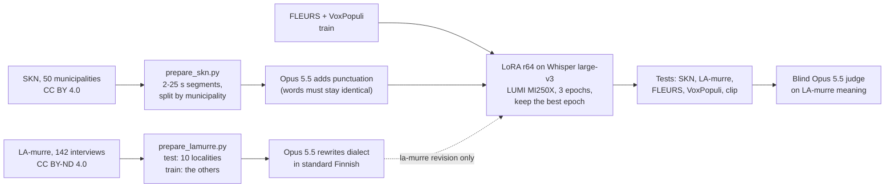

# Full report: every round, every judge

The [README](../README.md) gives the results and the current models. This page keeps the longer write-up of how
each version was made and tested, round by round, as it was written at the time: numbers in a section are from
that section's date, and later versions are in the README's [model table](../README.md#the-models-round-by-round).

## Contents

- [Fine-tuning pilot](#fine-tuning-pilot-whisper-large-v3-on-open-finnish-data)
- [Our dialect model](#our-dialect-model): [round 1](#round-1-skn-dialects),
  [a second corpus](#a-second-corpus-la-murre), [round 2](#round-2-punctuation-and-more-dialect-speech)
- [Timestamps and long-form audio](#timestamps-and-long-form-audio-full-measurements)
- [How far the LLM judges can be trusted](#how-far-the-llm-judges-can-be-trusted)
- [Second opinions: open-model judges on CSC Aitta](#second-opinions-open-model-judges-on-csc-aitta)
- [Dialect data and next steps, 15–20 Oct 2026](#dialect-data-and-next-steps-1520-oct-2026)
- [The clip summary of 13–15 Oct 2026](#the-clip-summary-of-1315-oct-2026)
- [Reviewed reference of the Ajokortti clip](#reviewed-reference)
- [Ten dental webinars (references not checked)](#ten-dental-webinars-references-not-checked)

## Fine-tuning pilot: Whisper large-v3 on open Finnish data

Can the open training data improve the best open model? A LoRA fine-tune of Whisper
large-v3 (1 % of the weights, rank 32 on the attention query and value projections) on
the FLEURS and VoxPopuli Finnish training sets: 10 208 recordings, 2 epochs, 51 minutes
on one MI250X. Validation loss fell from 0.48 to 0.17.

| Test | Whisper large-v3 | After fine-tuning |
|---|--:|--:|
| FLEURS WER % | 7.4 | 7.1 |
| VoxPopuli WER % | 12.7 | 10.8 |
| Ajokortti clip WER % | 14.7 | 17.9 |
| Ajokortti, Claude / Gemini error points | 2.7 / 5.2 | 2.2 / 8.2 |

It got better on speech like its training data and not on the webinar: WER on the
clip rose and the two judges disagree on the direction. Finnish-NLP's and RASMUS's
models, trained on the same kind of data, show the same pattern (good on FLEURS and
VoxPopuli, behind base Whisper on the clip). Open read and parliamentary speech is
not the data that makes a model better at spontaneous Finnish; that needs spontaneous
and dialect speech (see below). The training log is in
[`results/finetune/`](../results/finetune/whisper-large-v3-fi-pilot/train_log.json);
the adapter is not published. `lumi.sh run train hf --name <name>` repeats it
with other settings.

## Our dialect model

> **Walk-through for readers new to this:** the story page, [in English](https://gaik-project.github.io/finnish-asr/story/story.en.html)
> and [suomeksi](https://gaik-project.github.io/finnish-asr/story/story.fi.html) (sources:
> [`docs/story/`](story/)), explains the data, the four places where Claude Opus 5.5 was used,
> the training, both measurements, the three open judges, the checked webinar reference and the
> timestamp variant, with two audio examples. The files also work offline. To hear the models side by
> side, open the [listening page](https://gaik-project.github.io/finnish-asr/listen.html) (built by
> [`build_listen.py`](../scripts/build_listen.py)); [`build_compare.py`](../scripts/build_compare.py) builds a
> fuller local comparison that embeds the clip, so it is not committed.

### Round 1: SKN dialects

The pilot showed that read speech does not teach spontaneous Finnish. The second run
adds dialect interviews: **Suomen kielen näytteitä (SKN)**, Kotus / Kielipankki,
CC BY 4.0 ([urn:nbn:fi:lb-2020112937](http://urn.fi/urn:nbn:fi:lb-2020112937)), about
two hours of interview from each of 50 municipalities, every sentence time-aligned with
a dialect transcript and a normalised standard-Finnish one.

**Data.** [`prepare_skn.py`](../scripts/prepare_skn.py) joins sentences into segments of
2–25 s and splits **by municipality**, so no test locality or informant is heard in
training: 38 municipalities for training (15 042 segments, 62 h), 2 for validation
(Pälkäne, Sotkamo; 200 segments) and every fifth SKN booklet, in publication order, for the
test (SKN05, 10 … 50; 600 segments). By Kielipankki's classification the test covers the
south-western, south-western transitional, Häme, Savo and south-eastern dialects; all nine
Ostrobothnian and Peräpohjola municipalities are in training. Interviewer speech is kept, and
some SKN fieldworkers recorded both test and training municipalities, so a few test segments
may contain an interviewer's voice heard in training. The target is the normalised text,
so the model learns to write standard Finnish from dialect speech.

**Training.** The same LoRA recipe as the pilot (rank 32, 2 epochs, learning rate 1e-4)
on SKN plus FLEURS and VoxPopuli train: 25 250 segments, 2 h 2 min on one MI250X (training with
per-epoch validation, from its `train_log.json`).
Validation loss (SKN and the open sets together) fell from 0.55 to 0.21.

| Test | Whisper large-v3 | Pilot (open data) | + SKN dialects |
|---|--:|--:|--:|
| SKN dialect test WER % (10 held-out municipalities) | 40.4 | – | **22.2** |
| SKN dialect test CER % | 19.1 | – | **9.0** |
| FLEURS WER % | 7.4 | 7.1 | 7.8 |
| VoxPopuli WER % | 12.7 | 10.8 | 10.6 |
| Ajokortti clip WER % | 14.7 | 17.9 | 17.9 (14.9 chunked) |
| Ajokortti, Claude / Gemini error points | 2.7 / 5.2 | 2.2 / 8.2 | 4.5 / 9.4 (3.7 / 9.7 chunked) |

WER on the dialect test fell in every one of the 10 municipalities:

| Municipality | Alastaro | Artjärvi | Eurajoki | Heinola | Hinnerjoki | Ikaalinen | Jaala | Mikkeli | Rautu | Vihti |
|---|--:|--:|--:|--:|--:|--:|--:|--:|--:|--:|
| Whisper large-v3 | 35.7 | 44.4 | 43.7 | 36.1 | 51.8 | 31.3 | 37.3 | 38.5 | 50.4 | 32.8 |
| + SKN dialects | 19.7 | 23.3 | 23.4 | 20.6 | 30.6 | 16.2 | 19.6 | 19.9 | 33.4 | 15.3 |

**What it means.** Dialect data is what moves dialect accuracy: the error rate nearly
halves, and no ready-made model, including the Finnish fine-tunes trained on read
speech (48–57 %), comes close. FLEURS moved by 0.4 points the wrong way and VoxPopuli
improved, so general Finnish held. On the webinar clip the higher WER came from Whisper's
long-form decoding loop, not from the model: with the clip cut into the same chunks the
short-audio models get, it is 14.9 % against 15.7 % for base Whisper
([round 2](#round-2-punctuation-and-more-dialect-speech)). The judges still count more meaning
errors than for base Whisper (brand names, people's names and dental terms such as "oikoja" and
"etualue"); that clip is standard spoken Finnish with brand names, which SKN does not contain. Part
of the gain is learning SKN's own conventions (numbers as words, its normalised spellings), which
WER rewards; the [second corpus](#a-second-corpus-la-murre) below separates the two.
The training log is in
[`results/finetune/`](../results/finetune/whisper-large-v3-fi-skn/train_log.json); round 1 was not
published (round 2 is). [`docs/DIALECT-EXAMPLES.md`](DIALECT-EXAMPLES.md) shows 20 test
segments side by side for the published model.

**Attribution.** Suomen kielen näytteitä, Kotimaisten kielten keskus (Kotus), via
Kielipankki – The Language Bank of Finland, CC BY 4.0. The segments and transcripts
quoted in [`results/benchmarks/skn_fi/`](../results/benchmarks/skn_fi/) and
[`results/labels/`](../results/labels/) come from it.

### A second corpus: LA-murre

Is the gain dialect skill, or only SKN's own conventions? The fine-tuned model was run on
a corpus it has never seen any part of: the Finnish Dialect Syntax Archive (LA-murre),
recorded and transcribed by other people, 10 localities outside SKN's 50 municipalities,
one per dialect region.

WER cannot answer it. LA-murre's reference is written in dialect, so a model that writes a
dialect word in its standard form is charged an error, and the model that copies dialect
spellings best (Finnish-NLP, 51.6 %) has the lowest WER. The fine-tune still improves on base
Whisper (62.5 → 57.9 % WER, 22.9 → 17.0 % CER) and leaves far less out (deleted words
12.9 → 2.6 %).

So a blind judge read the meaning. Claude Opus 5.5 got the dialect reference and three
transcripts per segment, labelled A, B, C in shuffled order, and counted only meaning
errors (wrong word, name or number, missing or invented content); standard against
dialect forms is not an error ([`judge_dialect.py`](../scripts/judge_dialect.py)).

| Model | Error points / 100 words | Critical | Major | Minor | Segments with no error |
|---|--:|--:|--:|--:|--:|
| **Whisper large-v3 + SKN dialects (this project)** | **13.9** | 16 | 309 | 654 | 108 |
| Finnish-NLP whisper-large-finnish-v3 | 21.6 | 38 | 482 | 864 | 49 |
| Whisper large-v3 | 22.7 | 41 | 527 | 798 | 55 |

564 of the 583 segments (the judge left a verdict out for 19 long ones, three attempts
each). Critical 10, major 5, minor 1 point. Segment by segment the fine-tune has fewer
points than base Whisper in 350, more in 101 and the same in 113 (sign test p < 0.001),
and it is ahead in every locality:

| Locality | Tammela | Posio | Muolaa | Laukaa* | Iitti* | Sodankylä* | Laihia | Temmes | Nilsiä* | Rauma |
|---|--:|--:|--:|--:|--:|--:|--:|--:|--:|--:|
| Whisper large-v3 | 14.0 | 21.7 | 22.0 | 20.0 | 26.2 | 32.9 | 19.0 | 16.0 | 30.9 | 33.7 |
| + SKN dialects | 10.9 | 12.7 | 16.7 | 7.4 | 14.4 | 19.2 | 13.2 | 10.7 | 16.1 | 27.8 |
| Finnish-NLP fine-tune | 15.3 | 20.0 | 21.4 | 20.8 | 25.3 | 25.1 | 15.8 | 18.0 | 28.7 | 30.8 |

\* read from the corpus file code (`kess_lau1`, `kyml_iit1`, `perpl_sod1`, `savp_nil1`); the other
six place names are also said in the interviews.

The gain carries over to dialect speech from another corpus: about 40 % fewer
meaning-error points than base Whisper in this judging (47 % when the same transcripts were
judged again in round 2 below), about the size of the WER gain on SKN. One judge, itself a model,
and one fine-tune run; Rauma stays hard for every model.

**Attribution.** Finnish Dialect Syntax Archive (Lauseopin arkiston murrekorpus),
University of Turku and Kotimaisten kielten keskus, via Kielipankki, CC BY-ND 4.0
([urn:nbn:fi:lb-2020112935](http://urn.fi/urn:nbn:fi:lb-2020112935)). No LA-murre text is in
this repository: the references were modified (two annotation marks removed, as
`prepare_lamurre.py` describes) and the licence is no-derivatives, so only numbers made from them
are published (`scores.json`, the judges' `summary*.json` and `agreement-r2.json`).

### Round 2: punctuation and more dialect speech

Round 1 showed that dialect data is what moves dialect accuracy. Round 2 asked what
else helps, with the same base model and method, and picked the model to keep by validation
loss, never by test scores.




**1. Training text with punctuation.** SKN's standard-Finnish text has no punctuation and
almost no capitals, so round 1 learned to write almost none (1 of its 600 SKN test outputs has a
full stop or comma; base Whisper 97.5 %). [`prepare_targets.py`](../scripts/prepare_targets.py)
had Claude Opus 5.5 add punctuation and capitals to every training and validation segment,
20 per call, and threw away any answer whose words were not exactly the input's: 15 024 of
15 042 passed, the other 18 kept their plain text. The text-only LLM never hears audio and
never touches a test set. The targets are in
[`results/labels/`](../results/labels/skn_train.targets.jsonl).

**2. More dialect speech.** LA-murre's other recordings, without the 10 test localities, a
second recording from one of them and the five localities that are also SKN test
municipalities, give 15 532 segments (56 h). Their transcripts are in dialect spelling, so
Opus rewrote each one in standard Finnish, word for word; 15 529 kept a word count within 30 %
of the source. LA-murre is CC BY-ND, so the rewritten texts are not published; the model is, as the
`la-murre` revision.

**3. Training.** LoRA rank 64 on the attention query and value projections (2 % of the
weights), learning rate 1e-4, batch 8, on one MI250X. A four-epoch run showed overfitting:
validation loss was lowest after epoch 2 and rose after it (0.206, 0.208, 0.215), so the
final runs train three epochs and merge the epoch with the lowest validation loss, which
was epoch 2 in both. Published model: 25 250 segments, 3 h 8 min. LA-murre model:
40 779 segments, 4 h 57 min (training with per-epoch validation, from the `train_log.json` files).

| Model | Training data | SKN WER | LA-murre judge pts | FLEURS | VoxPopuli | Clip WER (chunked) | Clip Claude / Gemini pts |
|---|---|--:|--:|--:|--:|--:|--:|
| Whisper large-v3 | none | 40.4 | 25.9 | 7.4 | 12.7 | 15.7 | 1.7 / 5.5 |
| Round 1 (r32, 2 epochs) | SKN + open | 22.2 | 13.8 | 7.8 | 10.6 | 14.9 | 3.7 / 9.7 |
| **Round 2, published** | SKN with punctuation + open | 21.1 | 13.6 | **7.6** | 10.8 | **13.9** | 6.7 / 10.9 |
| Round 2 + LA-murre (`la-murre` revision) | + LA-murre rewritten | **19.7** | **11.4** | 7.8 | 11.4 | 15.9 | 3.0 / 6.2 |

WER in %, lower is better. LA-murre judge: meaning-error points per 100 reference words,
Claude Opus 5.5, all four models judged together on each of the 583 segments in shuffled,
unlabelled order (round 2 of [`judge_dialect.py`](../scripts/judge_dialect.py)). Its scale
differs from the round-1 judging above, which compared other models: base Whisper gets 22.7
points in round 1 and 25.9 in round 2 (critical errors 41 and 74), the round-1 model 13.9 and
13.8. Compare models only within one round. The four-epoch variants are in
`results/benchmarks/*/scores.json` (`-r64e4`, `-punct`, `-lamurre`); their last epoch is slightly
better on SKN and worse on VoxPopuli.

**What it shows.**
- **Punctuation came back at no cost.** The published model writes punctuated sentences
  like base Whisper and is level with round 1 on dialects: SKN 21.1 against 22.2 % WER, and
  on LA-murre the judge cannot separate them (13.6 against 13.8 points; fewer points in 168
  segments, more in 138, sign test p = 0.10).
- **More dialect speech helps, and it carries over.** The LA-murre model is best on both
  dialect tests: on LA-murre it has fewer points than round 1 in 234 segments and more in
  121 (p < 0.001), and fewer points than round 1 in all 10 localities; it is the lowest of the
  four models in 9 of them (the published model is lower in Muolaa, 12.1 against 13.1). Part of
  that is being trained on the same corpus as the test, though not on its localities. It is
  published as the `la-murre` revision; its training texts stay unpublished under LA-murre's
  licence, so a larger CC BY dialect corpus would be the way to share the data behind such a gain.
- **Names and terms on the webinar get worse with dialect training.** Every dialect model
  gets more meaning-error points on the clip than base Whisper. The published model has the
  lowest WER on the clip but gets 11 and 10 of 14 names right against 14 and 14 for base
  Whisper ("Nobelbayer" for Nobel Biocare, "Densplay-sirvana" for Dentsply Sirona); round 1
  matches base Whisper on Claude's name check (14 of 14) and trails by one on Gemini's. For webinar
  audio with brand names, base Whisper large-v3 remains the better choice; for dialect speech, ours.
- **Decode in chunks.** Whisper's own long-form loop made the round-2 models repeat one phrase over
  and over at the end of the clip (38.8 % WER for the four-epoch run, 62.7 % for the published
  model). Feeding 15–25 s chunks cut at quiet points (`run_open_models.py`, recipe `whisper_chunks`)
  removes it. The model card's table of decoding settings is the published model downloaded back
  from the Hub and run on the clip six ways
  ([`results/clip/decoding_check.json`](../results/clip/decoding_check.json), scored by
  `score_asr.py --decoding` into [`decoding_scores.json`](../results/clip/decoding_scores.json)):
  quiet-point pieces 13.7 % WER, the pipeline's `chunk_length_s=20` 14.7 %, `chunk_length_s=30`
  52.5 % (it loops) and 14.4 % with `no_repeat_ngram_size=6`; against the reviewed reference 13.5,
  13.5, 51.5 and 14.2 %.

**Cost.** Opus 5.5 for the training text, about 100 USD (punctuation 52, LA-murre rewriting
49); the blind judging of rounds 1 and 2 about 25 USD (round 3, for the timestamp variant below, used
about as many tokens as each of them); about 40 GCD-hours of LUMI GPU time for every job in both
rounds (about 20 billed GPU-hours). The published model (tag `v1.0`), its variants (branches
`timestamps`, `all-skn` and `la-murre`) and its SKN segments are on Hugging Face
([model](https://huggingface.co/GAIK-project/whisper-large-v3-fi-dialects),
[dataset](https://huggingface.co/datasets/GAIK-project/skn-finnish-dialects-asr)); their cards are
in [`release/`](../release/) and [`publish_hf.py`](../scripts/publish_hf.py) uploads them. The rewritten
LA-murre training texts are not published.

**Attribution.** SKN as above. LA-murre: Lauseopin arkiston murrekorpus, University of Turku
and Kotus, via Kielipankki, CC BY-ND 4.0, used for testing and for the `la-murre` revision's
training.

## Timestamps and long-form audio: full measurements

The published model was trained on text without Whisper's timestamp tokens. Does that break its
timestamps and its long-form decoding, and does training with them help?
[`eval_timestamps.py`](../scripts/eval_timestamps.py) measured both against SKN's own sentence times
([`prepare_timestamps.py`](../scripts/prepare_timestamps.py)):

- **Boundaries:** the 600 SKN test segments decoded with `return_timestamps=True`. For each of the
  791 sentence starts inside a segment (after its first sentence), the distance to the nearest
  timestamp the model wrote there.
- **Long-form:** from each of the 10 test municipalities about 4 minutes of one interview
  ([`results/labels/skn_longform.jsonl`](../results/labels/skn_longform.jsonl), window edges in pauses
  no sentence crosses), decoded three ways: Whisper's own sequential long-form mode with timestamps;
  the same with OpenAI's temperature fallback (temperatures 0.0–1.0, compression-ratio threshold
  1.35, log-probability threshold −1.0, no-speech threshold 0.6, `condition_on_prev_tokens=False`),
  which decodes a 30 s window again at a higher temperature when its text compresses too well or its
  log-probability is too low; and 15–25 s pieces cut at the quietest 100 ms (the model card's code).
  A decode counts as a loop when one 5-word sequence occurs four times or more and more often than
  in the reference.

| Model | SKN sentence starts within 0.5 s / 1 s | Median distance | Long-form WER, sequential (loops) | Long-form WER, with fallback (loops) | Long-form starts within 1 s, with fallback | Long-form WER, pieces |
|---|--:|--:|--:|--:|--:|--:|
| Whisper large-v3 | 53.5 % / 60.8 % | 0.18 s | 37.5 % (0 of 10) | 37.5 % (0) | 62.6 % | 39.4 % |
| Published model | 0.8 % / 0.8 % | 5.33 s | 21.5 % (1 of 10) | 19.8 % (0) | 18.9 % | 17.3 % |
| Timestamp variant | 56.4 % / 57.8 % | 0.04 s | 25.2 % (3 of 10) | **18.1 %** (0) | 49.0 % | **17.1 %** |

The published model's timestamps are unusable: it writes them, but almost never where a sentence
starts. Its text is still good, and in pieces it is far ahead of base Whisper (17.3 % against
39.4 %). So decode it in pieces and take times from the cut points, as the model card's code does.
WER with timestamps on the short segments is 21.2 % (base 41.0 %), level with the scores above.
Results: [`results/timestamps/scores.json`](../results/timestamps/scores.json), raw decodes beside it.

### The timestamp variant

Can training put the timestamps back? `finetune_whisper.py --timestamps 0.5` repeats the published
model's recipe, but half of the SKN items, drawn again every epoch, carry one timestamp pair per SKN
sentence (`<|0.00|> text<|1.84|>`, times from
[`results/labels/skn_parts.jsonl`](../results/labels/skn_parts.jsonl)); 15 040 of the 15 042 training
items had usable times. Epoch 2 was kept, with validation loss 0.2158 (not comparable with the
published model's 0.206, because about half of its SKN validation segments carry timestamp tokens), after 3 h
6 min on one MI250X ([`train_log.json`](../results/finetune/whisper-large-v3-fi-skn-punct-ts/train_log.json)).

| Test | Whisper large-v3 | Published model | Timestamp variant |
|---|--:|--:|--:|
| SKN dialect test, WER % | 40.4 | **21.1** | 21.4 |
| FLEURS, WER % | 7.4 | 7.6 | 7.4 |
| VoxPopuli, WER % | 12.7 | **10.8** | 11.2 |
| LA-murre, WER % (dialect reference) | 62.5 | 58.1 | 58.1 |
| LA-murre, blind judge round 3, points per 100 words | 24.2 | 13.7 | 13.7 |
| Clip, long-form with timestamps, WER % (HY's / reviewed reference) | 14.7 / 13.7 | 62.7 / 62.2 (loops) | 16.7 / 16.2 |
| Clip, quiet-point pieces, WER % (HY's / reviewed reference) | 15.7 / 15.7 | **13.9 / 14.0** | 15.2 / 14.5 |
| SKN sentence starts within 1 s | 60.8 % | 0.8 % | 57.8 % |
| Long-form interviews with fallback, WER % | 37.5 | 19.8 | **18.1** |

The blind judge's round 3 ([`judge_dialect.py`](../scripts/judge_dialect.py) `--round r3`,
[`summary-r3.json`](../results/judgements_dialect/lamurre_fi/summary-r3.json)) judged base Whisper, the
published model and the variant together on 577 of the 583 LA-murre segments: 24.18, 13.72 and 13.68
points. The variant has fewer points than the published model in 98 segments and more in 100 (sign
test p = 0.94): no difference.

**Decision.** The published model stays the main model. The rule set before the run was that the
variant replaces it only if SKN gets at most about 0.5 points worse, FLEURS and VoxPopuli get no
worse, and the timestamps are usable. VoxPopuli got 0.4 points worse, so the variant did not pass; the
clip in pieces was also 0.5–1.3 points worse. The variant is published as the `timestamps` revision of
[GAIK-project/whisper-large-v3-fi-dialects](https://huggingface.co/GAIK-project/whisper-large-v3-fi-dialects/tree/timestamps)
(card: [`release/TIMESTAMPS_CARD.md`](../release/TIMESTAMPS_CARD.md)), and the main model is tagged
`v1.0`. Use the variant when you need sentence timestamps, or long audio transcribed without cutting
it yourself, and always with the fallback settings: without them it looped in 3 of the 10 interviews.

```python
import soundfile as sf
from transformers import pipeline

asr = pipeline(
    "automatic-speech-recognition",
    model="GAIK-project/whisper-large-v3-fi-dialects",
    revision="timestamps",
    dtype="float16",
    device="cuda",
)
audio, sr = sf.read("interview.wav", dtype="float32")  # 16 kHz mono, any length
out = asr(
    {"raw": audio, "sampling_rate": sr},
    return_timestamps=True,
    generate_kwargs={
        "language": "fi",
        "task": "transcribe",
        "temperature": (0.0, 0.2, 0.4, 0.6, 0.8, 1.0),
        "compression_ratio_threshold": 1.35,
        "logprob_threshold": -1.0,
        "no_speech_threshold": 0.6,
        "condition_on_prev_tokens": False,
    },
)
for chunk in out["chunks"]:
    print(f"[{chunk['timestamp'][0]:7.2f} s] {chunk['text'].strip()}")
```

## How far the LLM judges can be trusted

The judges are language models and they are noisy. On the clip, two arms with an identical
transcript, the Haaga-Helia WhisperX server's and HY's own run of the same set-up (a transcript HY
has not published, so it is not in this repository), got 4.5 and 3.5 points from Claude and 8.7 and
10.2 from Gemini, so read differences under about 2 points as ties. The same shows in this
repository on LA-murre: the same transcripts judged again in round 3, in other company and on 577 of
the 583 segments, got 24.2 instead of 25.9 points (base Whisper) and 13.7 instead of 13.6 (the
published model)
([`summary-r2.json`](../results/judgements_dialect/lamurre_fi/summary-r2.json),
[`summary-r3.json`](../results/judgements_dialect/lamurre_fi/summary-r3.json)). Gemini is stricter
throughout. Gemini also judges Gemini's own transcripts; Claude, which made no transcript, puts
Gemini 3.5 Flash first as well.

## Second opinions: open-model judges on CSC Aitta

Is the LA-murre result Claude's opinion only? Open models served by CSC's Aitta service (CSC's
OpenAI-compatible LLM API for Finnish research) judged round 2 again with the same prompt, answer
schema, labels and order as Claude ([`judge_dialect.py --provider aitta`](../scripts/judge_dialect.py),
compared by [`judge_agreement.py`](../scripts/judge_agreement.py) in
[`agreement-r2.json`](../results/judgements_dialect/lamurre_fi/agreement-r2.json)):

| Judge | Segments | Whisper large-v3 | Round 1 | Published | + LA-murre | Published vs base (fewer / more points) | Same preference as Claude |
|---|--:|--:|--:|--:|--:|--:|--:|
| Claude Opus 5.5 (reference) | 583 | 25.9 | 13.8 | 13.6 | 11.4 | 398 / 89 | – |
| gpt-oss-120b (Aitta) | 583 | 20.5 | 13.4 | 13.2 | 12.9 | 275 / 105 | 80.7 % of 1 535 pairs |
| Gemma 4 31B (Aitta), sample | 198 | 17.3 | 10.1 | 10.5 | 9.0 | 100 / 27 | 92.1 % of 544 pairs |
| Qwen3.6 27B (Aitta), sample | 197 | 23.0 | 11.8 | 11.3 | 9.3 | 121 / 27 | 92.8 % of 643 pairs |

Points are meaning-error points per 100 reference words. "Same preference" counts the pairs of
models in a segment where both judges see a difference, and how often they prefer the same one.
All four judges rank the models the same way: the LA-murre model best, the published model and round
1 about level, base Whisper far behind; gpt-oss-120b also finds the published model clearly better
than base Whisper (sign test p < 0.001) and separates the three fine-tunes less than Claude does.
Gemma 4 31B and Qwen3.6 27B were run on a sample, not on all 583 segments: both judged the same seeded
sample of 200 segments (`--per-locality 20`: 20 per locality, seed 0; Gemma answered 198, Qwen 197),
and Gemma puts round 1 just ahead of the published model. Point scales differ between judges, so compare
models within one judge.

## Dialect data and next steps, 15–20 Oct 2026

This clip cannot say how the models handle dialects. What it does show is the method:
a dialect test needs dialect audio with a transcript a person has checked, and a
decision on whether the transcript should keep the dialect forms or normalise them,
because WER punishes whichever the model does not do. The LLM judge is built to ignore
that difference and count only meaning.

Data that could serve as a dialect test set and as fine-tuning data:

| Dataset | What | Access |
|---|---|---|
| Lahjoita puhetta (Donate Speech) | About 3 600 h of spontaneous Finnish from over 20 000 speakers across Finland, part of it transcribed, with dialect metadata | Kielipankki; licence agreement, a fee for commercial use |
| Suomen kielen näytteitä (SKN) | Dialect recordings from 50 localities, with both dialect and normalised transcripts | Kielipankki, CC BY 4.0: **used here** for the dialect test and fine-tune |
| Lauseopin arkiston murrekorpus (LA-murre) | 142 dialect samples from 132 localities, dialect transcripts only | Kielipankki, CC BY-ND 4.0: **used here** as the second dialect test and for the `la-murre` revision |
| Common Voice, FLEURS, VoxPopuli (Finnish) | Read or formal speech, the sets the RASMUS model card reports | Open |

What was held out: the published model trained on all of the 38 training municipalities' segments.
The 2 validation and 10 test municipalities stayed out of training entirely, and the test uses 60
segments from each test municipality, so the rest of those 12 interviews (4 601 segments, 19.5 h) was
not used at all.

What was tried next (15 Oct 2026):

1. **All of SKN.** The same recipe on all 50 municipalities (19 643 segments, about 81 h; validation
   on FLEURS and VoxPopuli only), tested on what it had not heard. On LA-murre the blind judge
   (Claude Opus 5.5, all six models of the fourth round together, 583 segments) gives it 13.1 points
   against the published model's 14.2: fewer points in 177 segments and more in 114 (sign test
   p = 0.0003). FLEURS stays level (7.5 against 7.6 %), VoxPopuli gets worse (11.9 against 10.8 %),
   and on the ten dental webinars the judges see no difference (4.8 / 9.6 against 5.1 / 10.0 points).
   The rule set before the run allowed FLEURS and VoxPopuli at most 0.5 points worse, so it did not
   replace the published model; it is on the model's
   [`all-skn` branch](https://huggingface.co/GAIK-project/whisper-large-v3-fi-dialects/tree/all-skn)
   ([card](../release/ALL_SKN_CARD.md)) for audio that is mostly dialect.
2. **How well Opus rewrites dialect.** The prompt that turned LA-murre's dialect transcripts into
   standard Finnish for the LA-murre model, run on SKN's dialect transcripts of the 600 test segments
   and scored against SKN's human standard-Finnish text: 14.2 % WER, so the LA-murre model's training
   text is close to, not the same as, a person's normalisation.
3. **The API services on the dialect test.** gpt-4o-transcribe (through GAIK's Azure) leaves out 46 %
   of the dialect test's words (62.5 % WER) and gets the most meaning-error points on LA-murre (34.2);
   ElevenLabs Scribe v2 gets 44.9 % on SKN. Every service and model ran on FLEURS and VoxPopuli as
   well ([table](../README.md#public-test-sets-skn-and-la-murre-dialects-fleurs-and-voxpopuli)).

Settled on 20 Oct 2026: **a published model trained on LA-murre.** Asked whether a model trained on
LA-murre's standard-Finnish rewrites may be published, FIN-CLARIN (Kielipankki) assessed that its
weights most likely contain no copyright-protected part of the corpus, so no separate permission is
needed. The LA-murre model is now the `la-murre` revision ([card](../release/LAMURRE_CARD.md)).

Still open:

1. **The rewritten LA-murre texts.** They stay out of this repository and off Hugging Face;
   Kielipankki, which may distribute modified LA-murre material, has offered to take them in as a
   new version of the corpus.
2. **Today's speech.** Both dialect corpora are 1960s–70s interviews. Lahjoita puhetta (Donate
   Speech, about 3 200 h of everyday Finnish from all regions) would test present-day speech; it is
   CLARIN RES and needs a research plan and the project's public privacy notice.
3. **Names and terms.** Spontaneous standard Finnish with brand names and terms, the kind of speech
   the webinar clips have, where every dialect fine-tune here is weaker than base Whisper.
4. **Checked dental references.** HY's transcripts of the ten dental clips leave fillers out and were
   not checked by a listener; a reviewed version would make their word error rates meaningful.

## The clip summary of 13–15 Oct 2026

The first five points are about the Ajokortti clip (three minutes of a dental-education webinar, two
speakers, standard spoken Finnish with many names).

- 🏆 **Fewest meaning errors: Gemini 3.5 Flash**, first for both judges. Next come
  Google Chirp 3, ElevenLabs Scribe v2 and, as the best open models, plain **Whisper
  large-v3** and **large-v3 turbo**; the judges order those four differently.
- 📏 **WER ranks the models differently.** The Finnish-NLP Whisper fine-tune has the
  lowest WER (11.9 %) but more meaning errors than base Whisper large-v3 (14.7 %): it
  garbles brand names ("Nobel-Baker", "Kamloch-Konelloch"). ElevenLabs has a WER of
  18.2 % but only 5 minor errors for Claude, because it writes what was said ("mä", "semmonen")
  where the reference has standard forms. The reference also looks like a corrected
  WhisperX draft, which favours Whisper-family output on WER.
- 👂 **A listener's review of the reference confirms it.** After the 42 spans most systems
  disputed were checked by ear (14 corrected), the WhisperX lead disappears and the leading set
  sits within about one point, 13.2–14.2 % WER ([Reviewed reference](#reviewed-reference)).
- 🖥️ **Local and good enough: Whisper large-v3 or large-v3 turbo.** Every other open
  model is clearly behind on this clip: Orukeet, RASMUS Finnish Canary, Canary 1B v2,
  Parakeet v3 and wav2vec2 at 22–32 % WER.
- ❌ **Qwen3-ASR is not usable for Finnish**: 58 % WER (1.7B) and 78 % (0.6B), although
  Finnish is on its language list.
- 🇫🇮 **The Finnish Canary fine-tune did not beat its base on names.** RASMUS
  Finnish-ASR-Canary-v2 scores 22–24 % WER against 24 % for NVIDIA's Canary 1B v2, and
  gets fewer of the 14 names right (7–11 against 10–13). Its model card reports 4.6 %
  on Common Voice: read speech, not a webinar.
- 🗣️ **Dialects: every model struggles, and fine-tuning on dialect data nearly halves
  the errors.** On 600 dialect segments from 10 municipalities kept out of our training, the
  best ready-made open model (Whisper large-v3) has 40 % WER, the Finnish fine-tunes 48–57 % and
  the best API service we ran, Gemini 3.5 Flash asked for standard Finnish, 34.7 %. A LoRA fine-tune of Whisper large-v3 on 62 h of open dialect interviews
  (SKN, CC BY 4.0) brings it to **22 %**, better in all 10 municipalities, with FLEURS
  and VoxPopuli kept about level. A second, independent dialect corpus (LA-murre, 10
  other localities) confirms it on meaning: a blind judge gives the fine-tune 13.8
  meaning-error points per 100 words against 25.9 for base Whisper (round-2 judging),
  better in all 10 localities.
- 🛠️ **Our own model, round 2: punctuation back, and more dialect speech helps.** An LLM
  added punctuation to the training text (round 1 wrote almost none), and a second run added
  56 h of LA-murre interviews rewritten in standard Finnish. The published model keeps
  round 1's dialect accuracy (SKN 21.1 % WER, judge 13.6 against base Whisper's 25.9) and
  writes sentences. The one with LA-murre is the best on both dialect tests (19.7 %, 11.4
  points) and is published as the `la-murre` branch. On the webinar
  clip all of them spell rare names and dental terms worse than base Whisper
  ([Our dialect model](#our-dialect-model)).
- ⚖️ **Three open judges agree.** Given the same blind task on CSC's Aitta service, gpt-oss-120b
  (all 583 LA-murre segments) puts the four models in Claude's order and prefers the same model as
  Claude in 81 % of the pairs; Gemma 4 31B and Qwen3.6 27B, on a sample, in 92–93 %. Every judge
  ranks the LA-murre model first, the published model and round 1 about level, and base Whisper
  clearly last ([Second opinions](#second-opinions-open-model-judges-on-csc-aitta)).
- ⏱️ **Timestamps: a second variant.** The published model's own timestamps are unusable (1 % of
  SKN sentence starts get one within 1 s; base Whisper 61 %), so decode it in pieces. The same recipe
  trained with Whisper's timestamp tokens finds 58 %, keeps the dialect accuracy (SKN 21.4 %
  against 21.1 %) and, with OpenAI's temperature fallback, transcribes 4-minute dialect interviews
  in one go at 18.1 % WER without loops. It is published as the `timestamps` revision; the main
  model stays as it was
  ([Timestamps and long-form audio](../README.md#timestamps-and-long-form-audio)).
- 🆕 **15 Oct 2026: every service on every test set.** gpt-4o-transcribe, ElevenLabs Scribe v2,
  Chirp 3 and Gemini 3.5 Flash also ran on FLEURS, VoxPopuli and SKN: on read and parliament speech
  ElevenLabs is best (3.3 % and 9.1 %), on dialects every service is at 35–63 %. A fourth judging
  round (Claude, GPT-6.1-sol, gpt-oss-120b) puts Gemini and gpt-4o-transcribe behind base Whisper on
  LA-murre ([Do other AI judges agree?](../README.md#7-do-other-ai-judges-agree)), and on ten dental webinars
  judged on meaning Gemini 3.5 Flash is first, a hint only, since their references were never checked
  ([Ten dental webinars](#ten-dental-webinars-references-not-checked)).
  A model trained on all of SKN is the `all-skn` branch ([next steps](../README.md#dialect-data-and-next-steps)).
- 🤗 **Published 13 Oct 2026:** the model
  [GAIK-project/whisper-large-v3-fi-dialects](https://huggingface.co/GAIK-project/whisper-large-v3-fi-dialects)
  (Apache 2.0, tag `v1.0`; variants on its `timestamps`, `all-skn` and, since 20 Oct 2026,
  `la-murre` branches) and its SKN segments
  [GAIK-project/skn-finnish-dialects-asr](https://huggingface.co/datasets/GAIK-project/skn-finnish-dialects-asr)
  (CC BY 4.0). This repository holds the method, the code and the results behind them.

## Reviewed reference

This section is about the Ajokortti clip only. The README's [clip table](../README.md#the-ajokortti-clip) scores every set-up against the reference
the University of Helsinki (HY) wrote for the clip, which looked like a corrected WhisperX draft. On 14 Oct
2026 Akseli Leskinen listened to the 42 spans where most of seven systems hear something else and
corrected 14 of them: mostly spoken forms HY had written in standard Finnish, two missing words and a
brand name. The reviewed text is published next to the original in gaik-toolkit
([`reference.reviewed.txt`](https://raw.githubusercontent.com/GAIK-project/gaik-toolkit/main/evaluation_layer/eval_methods/transcription_eval/data/reference.reviewed.txt)).
Against it ([`results/scores.reviewed.json`](../results/scores.reviewed.json), `score_asr.py --reviewed`):

| Model | WER %, HY's reference | WER %, reviewed |
|---|--:|--:|
| OpenAI gpt-4o-mini-transcribe | 13.9 | **13.2** |
| Whisper large-v3 | 14.7 | 13.7 |
| Gemini 3.5 Flash | 14.2 | 13.7 |
| Our first model (`v1.0`), chunked ¹ | 13.9 | 14.0 |
| ElevenLabs Scribe v2 | 18.2 | 14.2 |
| WhisperX + Finnish-NLP whisper-large-finnish-v3 (Haaga-Helia WhisperX server) | 11.9 | 15.7 |
| Finnish-NLP whisper-large-finnish-v3 (plain transformers) | 13.2 | 15.7 |

The WhisperX-based arms lose their lead and ElevenLabs, which writes what is said, gains four
points: the review confirms that HY's text favoured WhisperX output. HY's own 2025 WhisperX file shows
the same shift (10.4 → 14.0 %; that transcript is not part of this repository). The leading set now sits within about
one point (13.2–14.2 %), which a 408-word reference cannot separate. Only the 42 disputed spans were checked, so read every WER here with the rest of the
reference still unverified. The clip table and the judges' scores are against HY's text and were
not re-run, and only these seven set-ups were scored against the reviewed text.

¹ The clip has not been run with the current main model (`parl`) or the `glossary` version yet.

## Ten dental webinars (references not checked)

> **Read this section as a hint only.** HY's references for these ten clips leave out fillers ("niinku",
> "tota") and were never checked against the audio; only the Ajokortti clip's reference has been
> ([above](#reviewed-reference)). Both the word error rates and the judges' points below are against these unchecked texts.

The Ajokortti clip is one of ten. The other nine come from the same QAdental webinar material: ten
180 s clips (30 minutes of speech), each with the University of Helsinki's Finnish
transcript (QAD-1 set A in HY's study). The files were checked against HY's originals: the same audio
and the same text byte for byte.


Because HY's texts leave fillers out, models that write what is said (ElevenLabs, Chirp, Gemini, our models) get
11–14 % inserted words and models that leave fillers out (Whisper, gpt-4o-transcribe) about 2 %. The blind judges
([`judge_dental.py`](../scripts/judge_dental.py)) ignore fillers; on their measure Gemini 3.5 Flash and ElevenLabs are
best and our dialect models among the last.

<!-- dental-table:start -->
| Model | WER % | Inserted words % | Meaning points, Claude Opus 5.5 | Meaning points, Gemini 3.1 Pro |
|---|--:|--:|--:|--:|
| Whisper large-v3 | 15.7 | 2.7 | 3.6 | 6.4 |
| Whisper large-v3, in 15–25 s pieces | 17.4 | 2.2 | – | – |
| OpenAI gpt-4o-transcribe (API, via Azure) | 19.1 | 2.4 | 5.3 | 9.1 |
| Whisper large-v3 turbo | 19.2 | 2.2 | – | – |
| OpenAI Whisper (API, via Azure) | 22.1 | 2.6 | – | – |
| **Ours: main model, in 15–25 s pieces** | 22.9 | 9.2 | – | – |
| Orukeet (Parakeet v3 fine-tune) | 24.4 | 2.3 | – | – |
| NVIDIA Canary 1B v2 | 24.5 | 2.2 | – | – |
| ElevenLabs Scribe v2 (API) | 25.4 | 11.4 | 1.6 | 2.8 |
| **Ours: all-skn version, in pieces** | 25.7 | 12.5 | 4.8 | 9.7 |
| **Ours: timestamps version, in pieces** | 25.8 | 12.9 | – | – |
| Finnish-NLP whisper-large-finnish-v3 | 25.8 | 12.7 | – | – |
| **Ours: first model (v1.0), in 15–25 s pieces** | 25.9 | 12.8 | 5.1 | 10.0 |
| Google Chirp 3 (API) | 25.9 | 11.3 | 2.3 | 3.7 |
| **Ours: la-murre version, in pieces** | 26.5 | 13.4 | – | – |
| Gemini 3.5 Flash (API, asked for standard Finnish) | 26.5 | 13.7 | – | – |
| **Ours: timestamps version, long audio in one go** | 27.0 | 13.0 | – | – |
| Gemini 3.1 Pro (API) | 28.5 | 11.4 | – | – |
| RASMUS Finnish-ASR-Canary-v2 + KenLM | 28.6 | 9.9 | – | – |
| Gemini 3.5 Flash (API, asked to write as spoken) | 28.6 | 14.0 | 1.2 | 2.1 |
| RASMUS Finnish-ASR-Canary-v2, greedy | 29.7 | 8.8 | – | – |
| **Ours: timestamps version**, whole clip in one go | 29.8 | 15.8 | – | – |
| NVIDIA Parakeet TDT 0.6B v3 | 32.3 | 1.8 | – | – |
| **Ours: main model (parl)**, whole clip in one go | 36.3 | 20.5 | – | – |
| Finnish-NLP wav2vec2 XLS-R 1B (no LM) | 42.1 | 5.9 | – | – |
| **Ours: la-murre version**, whole clip in one go | 60.0 | 44.9 | – | – |
| **Ours: first model (v1.0)**, whole clip in one go | 60.2 | 44.8 | – | – |
| Qwen3-ASR 1.7B | 93.7 | 35.4 | – | – |
<!-- dental-table:end -->

Meaning points: errors per 100 reference words over all ten clips (critical 10, major 5, minor 1).
Our models were run on 15–25 s pieces cut at quiet points; fed a whole 180 s clip in one go, the
published model repeats itself (45 % inserted words), and only the `timestamps` revision with its
fallback decode copes. HY's transcripts are private, so only the numbers are committed
([`results/benchmarks/dental10_fi/scores.json`](../results/benchmarks/dental10_fi/scores.json),
[`results/judgements_dental/summary.json`](../results/judgements_dental/summary.json)).
